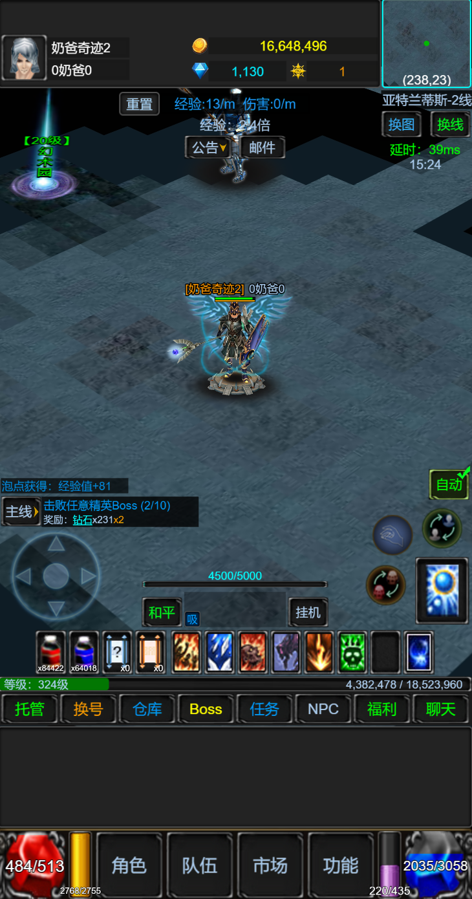

# 主界面布局基准

## 当前依据

用户于2026-10-26在本任务中上传截图并明确指定“主界面ui布局参考”。当前主界面布局以这张用户补充图为最高优先参考，配合《最终策划案》4.13及`client/AGENTS.md`实施。

- 项目保存位置：`UI参考图/用户确认/主界面UI布局参考.png`。
- 原始尺寸：730×1390像素；保留PNG原字节，未缩放、裁切或转成JPG。
- SHA-256：`efb48e433f26b2a6cf2c52ae6f5eeb351a132573ab726afc01ed4844aa135ee2`。
- 资料登记：`资料索引/用户确认参考.json`及`资料索引/UI参考映射.json`。
- 上级原有11张UI图仍保留。历史文档所写JPG尚未找到，本次图片作为用户最新指定的布局依据，不声明它与历史JPG或原有`主界面参考图.png`内容相同。

图片是布局和视觉关系的参考。图中的文字、数值、余额、等级、技能数量和玩法入口不构成新的产品规则。本阶段已制作主界面固定资产并接入已有玩法数据；最终验收见`docs/主界面阶段验收.json`，完整聊天、手机真机及全P0尚未完成。

## 画面分区

下表坐标是从截图识别的近似范围，用于说明相对位置，不作为Creator节点硬编码坐标。项目仍使用策划规定的720×1280设计基准，按窗口和安全区适配。

| 分区 | 截图中的相对位置 | 布局关系与实现边界 |
| --- | --- | --- |
| 角色与资源 | 顶部约0～136像素，头像靠左、资源居中、小地图靠右 | 头像、身份和资源形成顶部栏；四货币按策划分组明细，主栏优先显示当前操作所需余额 |
| 地图与场景信息 | 顶栏以下至约1048像素，场景信息在地图上沿 | 地图为主要视口；地图名称、位置、公告、系统邮件和网络状态按职责分组，地图实体用游戏坐标定位 |
| 地图上的任务提示 | 地图左下，约740～815像素 | 保留简短目标与进度，详情由普通面板承接，提示区域与摇杆不互相遮挡 |
| 八方向摇杆 | 地图左下，约815～970像素 | 使用触摸输入，避开底部血球、聊天和导航；固定承载节点保存在编辑器资产中 |
| 自动与手动操作 | 地图右下，约725～970像素 | 自动战斗状态和常用技能集中右侧，实际技能及入口以本角色配置和已开放玩法为准 |
| 药品与技能快捷栏 | 地图下沿，约974～1048像素 | 药品和常用技能集中排列；快捷槽不限制已学技能总数，具体槽位在正式交互设计中确定 |
| 等级与经验 | 快捷栏以下，约1048～1073像素 | 显示角色等级和经验，使用内置ProgressBar及Label |
| 便捷入口 | 约1073～1125像素 | 对应托管、换角、仓库、BOSS、任务等已批准功能，按功能分组收纳，保持可读字号和触摸区域 |
| 聊天区 | 导航与底栏之间，约1125～1283像素 | 参考其相邻关系；按策划默认折叠少量消息，展开后使用ScrollView、Mask、自定义List和内置EditBox |
| 血蓝与主导航 | 底部约1283～1390像素 | 血蓝状态分居两侧，角色、背包、功能/成长、交易及设置等入口按策划组织，停靠安全区底部 |

## 与最终玩法的适配

- 顶部三种图标只是参考画面，本作四钱包、金额精度和资源显示来源使用既有配置与服务端数据。
- 图中的“和平”不形成自由PK或攻击模式入口，“换线”不形成公共挂机线路功能；相关区域的正式内容按最终场景体系设计。
- 图中的“重置”不形成任意重置世界、刷新怪物或重领收益的操作。普通怪独立刷新、场景故障恢复和入场流程沿用最终策划规则。
- “队伍”对应获准的多人副本；系统邮件按系统通知/奖励使用，图片不开放玩家互发邮件。公告仍作为公告，不附带行会玩法。
- 自动战斗、托管和玩家手动接管分别表达状态，不能用一个按钮掩盖不同条件。面板、聊天、实体点击及后台切换保持地面导航目标。
- 图片中的大等级、大余额、具体技能图标与固定快捷槽数量均为示例，不写入正式玩法参数。

## Creator资产与适配要求

当前`client/assets/scenes/Game.scene`保存地图承载层与HUD固定结构，`client/assets/resources/prefabs/Entity.prefab`及`ListItem.prefab`保存动态实体与列表条目模板。顶部栏、战斗状态、摇杆、快捷栏、底部导航、消息面板及其列表模板均可在Creator编辑；固定节点不由运行时生成。

本阶段实现采用以下安全区逻辑尺寸；未叠加设备安全边距时，720×1280与720×1600的分配如下。上阶段顶部118、底部268的尺寸仅为首循环历史记录，不是当前布局。

| 容器 | 720×1280 | 720×1600 | 停靠与尺寸规则 |
| --- | --- | --- | --- |
| TopHUD | 高128 | 高128 | 顶部停靠，控件与字号不随高度增加 |
| MapViewport | 高808 | 高1128 | 上接顶部栏、下接底部栏，吸收增加的320高度 |
| BottomHUD | 高344 | 高344 | 底部停靠，快捷栏、经验、常用入口、消息区和血蓝组合保持固定高度 |

`ui180/`保存从只读1.80来源提取的30张原像素UI图及帧索引。已保存职业头像、四钱包详情、小地图与角色点、背包药品数量、HP/MP和经验、常用功能菜单。`GameHUD`只绑定引用和更新状态，小地图沿用地图贴图比例；血蓝使用内置ProgressBar及竖向FILLED Sprite，自动战斗使用Toggle。药品、未开放技能、BOSS和任务入口明确显示当前能力边界，战斗提示只展示真实自动/手动/死亡状态与怪物数量。

`GameMessages`展示当前会话观察到的真实系统记录，折叠区显示最近两条；展开后以ScrollView、Mask和自定义List复用条目，内置EditBox用于搜索记录，详情由PopupView承接。这里尚无聊天发送和世界聊天服务，不把本地记录称为世界聊天。

布局容器使用Widget与SafeArea，控件、文字和图标等比显示；宽屏增加地图视口宽度。全部Label字体大小至少24，参考图中较小文字在正式资产中按此调整。地图格数、碰撞和实体位置不随UI容器拉伸而改变，也不给地图实体添加Widget。

用户进一步明确：屏幕高度变高时，保持UI屏幕布局不变，只加高战斗视口，禁止拉伸。按以下方式实施：

- 在宽度和设备缩放条件相同、仅可用高度增加时，UI统一缩放比例、控件尺寸、字号、图标比例及固定面板高度保持不变；顶部栏仍停靠安全区顶部，血蓝、快捷栏、聊天和底部导航保持既定组合与底部停靠。
- 战斗视口容器由顶部HUD边界和底部HUD边界共同约束。安全区可用高度增加多少，中间战斗视口就增加多少；聊天区及其它固定面板不吸收这部分高度。
- 地图按原有格子、角色和贴图显示尺度绘制，视口扩大后展示更多世界区域。相机或可见区域随视口调整，不能把原先画面纵向拉满，也不能通过增大UI/角色来填满新增空间。
- 额外可见区域仍受真实地图边界、图层和裁剪规则约束，不新增可走格、刷怪点或碰撞数据。地图渲染和输入坐标换算使用新的视口范围，UI停靠变化不清除已有导航目标。
- 宽度增加采用同样原则，把额外宽度给地图视口；分别验收“同宽更高”和“同高更宽”，不使用CSS非等比铺满，也不逐帧重算固定UI布局。

面板、按钮、开关、进度、输入、滚动及裁剪使用对应Creator内置组件。EditBox保留默认组件树，文本子节点不额外挂Widget；Graphics仅用于地图、实体占位及确实没有对应UI组件的游戏绘制。

普通弹窗由UIMgr管理，详情/确认/帮助由独立PopupView覆盖；背景或返回关闭顶层后，下层和滚动位置保留，关闭动作不能穿透为地图点击。所有弹窗不放单独关闭按钮，生成工具不得覆盖已保存布局。

## 后续验收

本阶段自动检查与实际Creator构建已通过，构建期间源码稳定，6份scene/prefab布局哈希不变。720×1280、720×1600、960×1280及360×800浏览器复验、弹窗返回与滚动保留、系统消息搜索已通过，截图与验证边界见[主界面阶段验收](../../docs/主界面阶段验收.json)。手机真机安全区、后台切换和完整聊天另行验收。

## 17×17地图阶段补充

17×17菱形地图与土层阶段已完成限定本机开发验收。地图采用64×32地格、48像素土层，原289格来源证据保持；运行场边仅4件小型设施和装饰，4阻挡、285可走连通，移除大树及其旧阻挡，中央保持开阔。角色、怪物和宠物的名字为字号24、预制体缩放0.7，与血条稳定放在各自头顶，名字在上。快照`dev-isometric-map-v0.8-08f69b00879b`、rule_version8；玩法数值仍只维护两本唯一Excel。完整P0、手机真机、目标1.80完整认证及正式发布仍未完成。 固定UI尺寸与原停靠保持；World等比1，地图地板1088×544、含土层592高，小地图原容器内新增保存Surface136×68。窗口高度增加只扩大战斗视口，不缩放地板、土层、人物或HUD。具体场景有意差分、构建保护与浏览器尺寸证据见根目录地图阶段验收。
