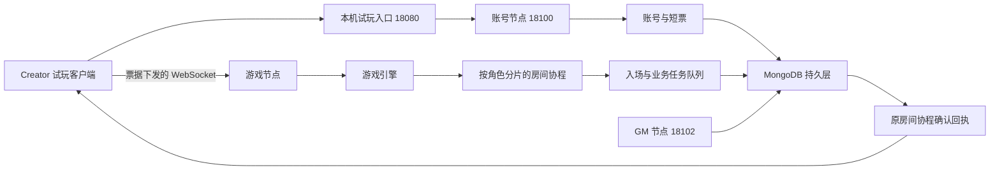

# 服务端解读文档

本文以规则 26 的本机试玩服务端为例，沿一次登录、选服、入场和击杀解释代码怎样协作。确认玩法与数值时先读最终策划和适配表，再查对应配置及代码。开发模式与正式发布有各自的门槛。 [最终策划案](../最终策划案.md) · [架构方案](../架构方案.md) · [架构适配与规则优先级](架构适配与规则优先级.md)

## 从入口读到资产落盘



建议依次查看 `main`、`Run`、`rpc`、`Engine.Enter`、`worker.command`、`worker.step`、`SettleWithReceipt`。第一次阅读先区分角色的内存现场和已确认资产，再跟踪请求或来源编号。 [程序入口](../server/cmd/nbserver/main.go) · [节点装配](../server/internal/bootstrap/app.go) · [房间引擎](../server/internal/game/runtime.go) · [结算入口](../server/internal/persistence/settlement.go)

| 目录 | 职责 | 从这里开始 |
| --- | --- | --- |
| `cmd/nbserver` | 读启动参数、加载配置、执行指定节点模式 | [main.go](../server/cmd/nbserver/main.go) |
| `cmd/toolchain-smoke` | 检查 Protobuf 往返、Argon2 和 WebSocket 依赖，可选检查专用副本集事务 | [main.go](../server/cmd/toolchain-smoke/main.go) |
| `internal/bootstrap` | 装配节点、申请和续约租约、监管进程、处理停服 | [app.go](../server/internal/bootstrap/app.go) · [node_lease.go](../server/internal/bootstrap/node_lease.go) |
| `internal/transport` 与 `internal/wire` | 注册 HTTP 和 WebSocket，收发应用帧并管理连接 | [http.go](../server/internal/transport/http.go) · [ws.go](../server/internal/transport/ws.go) · [frame.go](../server/internal/wire/frame.go) |
| `internal/devconfig` | 加载开发配置，限制端点，验证玩法快照和交叉引用 | [config.go](../server/internal/devconfig/config.go) |
| `internal/domain` | 定义角色、物品、成长、钱包、战报和协议视图 | [model.go](../server/internal/domain/model.go) · [progression.go](../server/internal/domain/progression.go) |
| `internal/game` | 管理角色房间、时间线、战斗、地图和托管，执行业务状态机 | [runtime.go](../server/internal/game/runtime.go) · [combat.go](../server/internal/game/combat.go) |
| `internal/townnav` | 提供共享静态碰撞图、复用搜索工作区和可分帧推进的路径任务 | [nav.go](../server/internal/townnav/nav.go) |
| `internal/persistence` | 管理账号、资产、事务、围栏、角色版本、流水和审计 | [store.go](../server/internal/persistence/store.go) · [lease.go](../server/internal/persistence/lease.go) |
| `internal/integration` | 通过真实入口或独立库验证跨模块流程 | [集成测试目录](../server/internal/integration/) |

## 节点怎样启动和停服

`nbserver` 支持 `supervisor`、`account`、`game`、`gm` 四种模式。默认监管进程用同一可执行文件启动三个子节点。各应用节点共用专用 MongoDB 副本集，GM 开发路由只提供受控只读查询。账号节点接收注册、登录、区服目录、角色目录、建角和取票。试玩入口把 `18080/account/rpc` 转发到 `18100/rpc`。游戏连接地址由票据下发，单节点同源代理可指向 `18080/game/ws`。游戏节点持有场景并处理 WebSocket。 [启动配置](../conf/dev/server.json) · [节点装配](../server/internal/bootstrap/app.go) · [HTTP 路由](../server/internal/transport/http.go)

游戏节点启动时用稳定的 `game_node_id`、本次 `boot_id` 和配置的 `run_server_ids` 向账号节点登记。数据库在同一事务确认节点身份和整组运行服所有权，分别推进各服的持久化围栏。任一服申请失败时整组回滚。同一节点一次续租覆盖全部获准的运行服。租期使用 MongoDB 时间计算，进程设有更早的本地安全截止，暂态网络或写确认问题只在剩余安全时间内重试。健康状态出来之前先确认初始续租。 [登记事务](../server/internal/persistence/game_registration.go) · [租约存储](../server/internal/persistence/lease.go) · [续租监视器](../server/internal/bootstrap/node_lease.go)

主动停服会先关闭新操作的准入，由原房间协程完成已经发生的结算和积累的整秒。结清期间继续维护游戏租约，失权时终止等待并由数据库围栏保护资产。关停超过等待预算或房间进入隔离时，报告未结清的错误。强制退出只能恢复最后已经提交的永久事实。 [结清流程](../server/internal/game/shutdown.go)

## 登录、入场和重连

1. 客户端通过试玩代理把注册或登录送到账号节点。账号存储随机盐和 Argon2id 摘要，认证发出的凭据用于查询区服目录、角色目录和短票。数据库保存凭据摘要并校验账号授权版本。 [认证和签票](../server/internal/persistence/auth.go)
2. 客户端选择区服后列出对应永久入口下的角色。账号节点按永久入口、运行服和部署节点解析当前有效路由并签票。客户端打开回包地址的 WebSocket 并递交入场短票。当前短票有效期为 45 秒，只能消费一次。传输层限制单连接入场次数、帧大小、待入场时间和发送缓冲，直接回应心跳。 [区服目录与路由](区服目录与游戏节点路由.md) · [WebSocket](../server/internal/transport/ws.go)
3. 票据读取和实际入场走不同队列。游戏引擎按票据选择运行服的持久化视图，再找到角色所在分片。持久事务检查并消费短票，绑定当前 `RunServerID` 和新的 `SessionEpoch`。一个角色的新连接取代旧连接。房间已有未完成结算时，等待原会话的结算关系解除后再接管。 [运行服上下文](../server/internal/game/run_scope.go) · [房间入场](../server/internal/game/runtime.go) · [数据库队列](../server/internal/game/database_jobs.go)
4. 游戏服先发入场结果及完整首基线。客户端收到全部分片并准备好场景后，用当前 `SceneEpoch` 和 `BaselineID` 确认。通过一次匹配的 ACK 才同步资产并发出 `SyncReady`。重复 ACK 不重复激活。 [基线编码](../server/internal/game/baseline.go) · [入场测试](../server/internal/integration/)
5. 健康重连可接管同一房间，继续使用原位置、生命代次、战斗效果和冷却。无连接、无有效托管且过去的业务已结清后，失活房间保留 60 秒再清退。故障后的新房间从永久角色状态重新建立临时场景。 [托管计量](../server/internal/game/hosting_meter.go) · [房间回收](../server/internal/game/room_lifecycle.go)

| 标识 | 管理范围 | 阅读时要核对的条件 |
| --- | --- | --- |
| `AuthVersion` | 账号凭据和持久授权 | 账号状态仍有效，授权版本一致 |
| `RunServerID`、`RunEpoch` | 单个运行服的游戏运行所有权 | 运行服、节点实例与该服的运行代次匹配租约和持久围栏 |
| `SessionEpoch` | 单角色的一次连接接管 | 当前连接的绑定值与角色、帧和事务匹配 |
| `SceneEpoch` | 连接中的当前场景 | 场景消息和 ACK 对应当前场景及基线 |
| `World.Ref`、实体句柄和 `Life` | 内存世界中的一个实体生命 | 延迟事件仍属于原世界和原生命 |
| `FactOrder` | 同房间已发生事件的处理次序 | 击杀和安全区绑定候选按原发生次序进入持久化流程 |
| `Revision` | 角色聚合的持久版本 | 事务的更新条件与实际旧版本一致 |
| `EconomicSeq` | 玩家主动经济命令 | 原 `op_id`、命令序号、预期版本和内容摘要一致 |
| `SourceSeq` | 服务端生成的来源业务 | 新流水恰好是下一序号，已进入永久回执覆盖范围的历史重试读取原回执 |

## 房间、地图和战斗

同一游戏进程承载的运行服共用一个游戏引擎。引擎按角色身份选定 8 个固定分片之一。每个分片用一个协程顺序处理本分片所有角色房间的普通指令、断开控制消息、数据库回调和约 100 毫秒一次的 tick。同一角色的连接、场景、实体和待确认事实都由这个协程管理。数据库执行器共享队列，任务沿用房间的运行服和持久化围栏。结果回到原分片后再次核对房间、授权和正在等待的操作。 [游戏引擎](../server/internal/game/runtime.go) · [任务执行](../server/internal/game/database_jobs.go)

当前个人挂机图使用共享的 13×13 静态地图模板，每个角色有独立的实体和战斗现场。个人寻路在分片工作区重用队列及访问标记，用当前实体坐标临时建立占位。城镇的只读碰撞图也可共享，分片按预算推进搜索并核对动态占位。当前紧凑城镇是 17×17，换图经历准备、提交和新场景确认。延迟事件仍按原世界和实体生命校验。 [地图定义](../server/internal/devconfig/map.go) · [个人寻路](../server/internal/game/personal_navigation.go) · [城镇寻路](../server/internal/game/town_navigation.go) · [换图状态机](../server/internal/game/map_travel.go)

战斗由服务端检验位置、朝向、存活状态、职业技能、消耗和冷却。玩家命令表达意图，自动战斗复用同一规则。定点自动模式保留现有坐标并锁定当前有效目标。一次普攻或施法受理后，计划事件进入时间线，到期时再按实际世界、目标和生命检查效果。击杀先形成可追溯的战斗事实，怪物倒下后按自己的计时在可用格复活。 [战斗主循环](../server/internal/game/combat.go) · [自动目标](../server/internal/game/auto_target.go) · [到期事件与击杀事实](../server/internal/game/timeline.go)

### 哪些状态会跨进程保留

| 临时房间状态 | 永久角色聚合 |
| --- | --- |
| 当前网格位置、HP、MP、实体、攻击和施法冷却 | 角色身份、等级、经验、技能和钱币 |
| 怪物生命、复活截止、宠物及场景缓冲 | 背包、装备、耐久和已确认的安全区绑定 |
| 最新连接、寻路过程、未提交的战斗事件 | 托管余额、已确认的战报、领取日和流水水位 |

健康重连的内存复用和故障后的重新入场具有不同恢复边界。查看争议资产时先核对持久版本、回执与审计。查看位置或战斗动作时先定位房间、世界和生命代次。 [角色聚合](../server/internal/domain/model.go) · [内存现场](../server/internal/game/runtime.go)

## 经济请求与击杀怎样提交

玩家发起装备、分解、技能学习、仓库、NPC 买卖和修理等操作时，原 `op_id` 表示这一次请求，命令序号与预期版本保护顺序。服务端根据当前角色、物品、商店等权威状态计算结果。公开给客户端的成功回执与资产新版本关联。已处理操作用同一身份重试时返回原确认，内容改变时报告冲突。 [资产操作](../server/internal/persistence/assets.go) · [技能资产](../server/internal/persistence/skill_assets.go) · [仓库](../server/internal/persistence/warehouses.go)

NPC 买卖与修理由游戏层检查角色与 NPC 的位置关系，再由持久层核对报价和资产条件。使用药水先确认物品扣减，实际 HP 或 MP 恢复随后在房间按效果和时间推进。这样可以分别检查资产是否已经变更和战斗现场是否已经观察到效果。 [NPC 交互](../server/internal/game/npc_shop.go) · [NPC 报价](../server/internal/persistence/npc_quote.go) · [药水](../server/internal/game/potions.go)

击杀和扣时等服务端事实使用 `SourceSeq`。击杀发生时冻结怪物、目标生命、来源时间和掉落所需事实。新来源读取角色持久水位，把运行组围栏、账号围栏、角色版本更新、永久回执和审计提交在同一事务里。结果未知或队列暂时繁忙时，继续使用原来源和内容摘要重试。授权失效或永久身份冲突会隔离房间，避免以新授权重写旧流水。 [击杀时间线](../server/internal/game/timeline.go) · [永久收益](../server/internal/persistence/settlement.go)

| 持久对象 | 用途 |
| --- | --- |
| `accounts`、`account_tokens`、`entry_tickets` | 保存账号授权、凭据摘要、角色关联及一次性入场身份 |
| `roles` | 角色聚合的资产、版本和已确认来源水位 |
| `warehouses`、`warehouse_items` | 保存仓库的版本和各槽位资产，由同一事务与角色背包协调 |
| `origin_routes`、`run_servers` | 保存永久入口的分区目录与路由、运行服的节点分配和连接地址 |
| `run_control`、`node_leases`、`run_guards`、`game_boots` | 记录各服代次、节点承载集合和启动实例的获准范围，利用条件写入阻止旧实例修改资产 |
| `operations` | 保存幂等操作身份、内容摘要和按业务类型保存的永久回执 |
| `audit_outbox` | 为对应的永久提交留下可核对的业务事实 |

同账号的业务在进入 MongoDB 前按 32 组安排本地围栏槽位，减少同组持续冲突。快照读、多数确认、围栏更新和角色版本核对分别负责事务一致性、提交确认、授权和并发修改。业务及入场有各自执行队列，游戏线程等待回调期间仍可为其他角色处理消息。 [围栏槽位](../server/internal/persistence/run_guard.go) · [MongoDB 存储](../server/internal/persistence/store.go)

## 离线托管的计量与结算

角色断开后，地图类型、存活、自动战斗和余额条件全部满足才继续托管。离线会话按 tick 累积实际处理时间，房间临时保留不足一秒的余量。当前会话积累的整秒优先与击杀或装备磨损同一笔提交。满 3 秒或达到余额边界时触发检查点。待确认阶段暂停新战斗和扣时。在线自动战斗期间不消费离线时长。 [房间计量](../server/internal/game/hosting_meter.go) · [战斗调度](../server/internal/game/combat.go)

MongoDB 成功确认后，余额、击杀收益、战报、来源水位及永久回执一起可查。受控停服结清可提交的整秒，进程强制退出时未提交的临时窗口可能随现场丢失。最终本机同口径 5000 角色长测中，击杀收益确认 P99 为 155.2 毫秒。该数据覆盖个人图混合负载，正式多机、公共玩法及更长运行仍有独立验收。 [停服结清](../server/internal/game/shutdown.go) · [复测报告](13格挂机图托管合并结算复测.md)

## 按问题定位代码

| 当前现象 | 优先查看 | 再核对 |
| --- | --- | --- |
| 网页打开但登录失败 | `transport/http.go` 的 `rpc` 与 `auth` | 账号授权版本、令牌摘要与回环代理路径 |
| 取票成功后进不去 | `transport/ws.go` 的入场计时及 `runtime.go` 的首基线 | 票据是否被消费、连接代次、场景和基线 ACK |
| 房间数增长 | `room_lifecycle.go` 的保留条件 | 在线、托管、结算在途、入场和闲置房间分别计数 |
| 技能未释放或伤害异常 | `combat.go`、技能执行和时间线 | 已学习技能、输入序号、冷却、距离、原世界与当前目标生命 |
| 客户端显示扣款或收益不一致 | 持久请求和 `settlement.go` 的回执 | `op_id` 或 `SourceSeq`、角色 `Revision`、审计，以及读到的客户端快照版本 |
| 写确认变慢或游戏掉线 | 数据库队列、应用事务与 MongoDB 提交耗时 | 长队列和提交失败分别定位，失权另看续租监视日志 |

## 协议与配置生成文件

手写服务端文件的首段概括文件职责，声明和关键流程旁说明变量、字段、方法及状态转移。测试文件的首段说明验证目标。生成文件可通过下列入口追溯源定义。

| 生成文件 | 修改源 |
| --- | --- |
| `server/api/generated/minimirv1/*.pb.go` | [共享 Protobuf 源](../shared/proto/) · [Go 协议生成工具](../tools/protocol/generate_go_pb.py) |
| `server/internal/protocol/protocol_ids.go` | [协议号生成器](../tools/config/generate_protocol.py) · [共享协议清单](../shared/proto/protocol_manifest.json) |
| `server/internal/configtypes/config_types.go` | [配置 schema](../config/schema/) · [配置维护说明](../config/README.md) |

实际开发配置由玩法与架构工作簿、schema 和导出工具维护。规则快照的版本和校验摘要可以用于比对服务端、客户端和验收样本。 [配置维护说明](../config/README.md) · [规则快照](../config/development/first-loop.json)

## 本机运行与检查

当前开发装配的几个预算有助于判断问题发生在哪一层。

| 预算 | 当前值 | 代码入口 |
| --- | --- | --- |
| WebSocket 接入 | 单进程 128 个连接，升级后 10 秒内取得首个绑定 | [ws.go](../server/internal/transport/ws.go) |
| 应用帧和发送缓冲 | 单帧最多 64 KiB，普通发送队列最多 128 帧及 256 KiB | [frame.go](../server/internal/wire/frame.go) · [ws.go](../server/internal/transport/ws.go) |
| 个人房间 | 8 个分片，每个分片最多 256 间，普通失活保留 60 秒 | [runtime.go](../server/internal/game/runtime.go) · [room_lifecycle.go](../server/internal/game/room_lifecycle.go) |
| 数据库任务 | 48 个业务执行器、6 个独立入场执行器，业务与结算按队列安排 | [database_jobs.go](../server/internal/game/database_jobs.go) |
| 存储和租约 | 32 个围栏组，事务预算 3 秒。普通续租间隔 3 秒，持久租期 15 秒，本地预留 3 秒安全余量 | [run_guard.go](../server/internal/persistence/run_guard.go) · [node_lease.go](../server/internal/bootstrap/node_lease.go) · [lease.go](../server/internal/persistence/lease.go) |

5000 角色压测使用独立构建和调高后的接入预算。运行预算表描述日常试玩启动的配置。 [压测复现方式](13格挂机图托管合并结算复测.md)

在仓库根目录，通过锁定工具链执行下列命令。MongoDB 属于项目专用开发环境，测试用例按自己的前缀和清理范围隔离数据。

```powershell
.\tools\dev.ps1 task dev-status
.\tools\dev.ps1 task dev-start
.\tools\dev.ps1 task dev-stop
.\tools\dev.ps1 go test ./...
.\tools\dev.ps1 task server-integration-test
```

试玩浏览器访问 `http://127.0.0.1:18080`。服务端进程登记在 `server/.dev/runtime.json`，客户端代理状态在 `.work/client-dev/`。查运行问题时，用 `dev-status` 核对当前节点实例与配置摘要，再按登记文件中的日志路径定位。 [本地运行约定](../README.md) · [服务端进程工具](../tools/server/dev.py) · [集成测试工具](../tools/server/test.py)
