# 游戏服务端完整架构方案

## 1. 目标与交付边界

面向格子地图 MMO，采用 Go 编写权威服务端，由个人配合 AI 开发维护。一个可执行文件按参数启动 account、gm、game 节点或主机监管器；生产拓扑为一个 accountNode、一个 gmNode、多个 gameNode。MongoDB 是永久业务和运行所有权的权威存储，Redis 是可选的可重建缓存，不参与资产和运行权裁决。

本文件包含开发所需的职责划分、线路规则、数据结构、状态机、协议约束、事务边界、故障恢复、运维和验收要求，可独立使用。玩法数值通过明确的业务配置接口提供；未提供有效价格、掉落表或权限规则时，关闭对应入口，不能使用猜测数值收费或发奖。

容量目标：每条公共 Line 支持配置 100～500 个角色，一张地图可配置 300 人线或 500 人线；500 人分散在大地图上，不承诺 500 人全员同屏。每个运行服 run_server 以 3000 个活跃角色为验收目标。ONLINE、MANAGED 都是实际运行角色；托管运行真实 AI，不采用离线收益公式替代。

### 1.1 产品规则总表

| 项目 | 确定规则 |
| --- | --- |
| 空间层级 | gameNode → run_server → room → Line；Line 是独立空间和战斗推进单位 |
| 公共线路 | 地图配置显式列出线路、类型和容量，不按人数自动增线；攻城、挑战地图可以只有一条 |
| 默认入线 | OFFLINE 入场优先该地图上次成功线路，再选择其它有权限、有空位的线路 |
| 排队 | 仅 OFFLINE 准备入场、且该目标地图所有可进入线路都满时提示排队；换线、换地图等其它场景遇满直接拒绝 |
| 接管 | MANAGED → ONLINE 复用原实体、原名额，线路满员不阻止接管 |
| 摊位影子 | 仅主城公共 line_id=1 显示；市场资产和订单属于运行服，不属于影子 |
| 副本 | 队伍私有 Line，非成员不可见、不可进入 |
| Line 配置 | 类型、数量、容量、PK/死亡规则和进入权限均随重启生效 |
| 道具加价 | 建立新的价位轮次，竞购截止时间保持不变 |
| 直购 | 商品进背包，检查背包，不检查摊位仓库容量；竞购、加价检查并预留摊位仓接收容量 |
| 共享仓库 | 资产按账号+origin 保留，同界面分页；每手动付费激活一仓贡献 50 格，共用总容量，最多 300 格 |
| 账号 | 本地账号和密码分别为 6～20 位数字、字母、下划线；第三方 UID 不套用这些限制 |
| 死亡 | 全部致死来源走统一处罚入口；由死亡所在 Line 类型决定 PK、掉经验、爆装和击杀加红 |
| 托管 | 野外断线且有剩余时长即转托管；托管被玩家击杀先回城复活、再离线 |
| 托管购买 | 金币购买、等级段定价；单次最多 24 小时，购买前剩余达到 24 小时禁止购买 |
| 红名 | 每次受配置约束的玩家击杀增加 1000；0～499 白名、500～1000 黄名、1001 起红名 |
| 交易 | 两类市场都禁止同账号自买自卖；允许按规则反复上下架 |
| 恢复 | Line 恢复后托管角色原位置继续，同一托管会话和统计不清空 |

## 2. 进程拓扑、身份与路由

```mermaid
flowchart TB
    C[游戏客户端] -->|认证、选服、角色目录、票据| A[accountNode]
    C -->|TCP / HTTPS / WSS + Protobuf| G[多个 gameNode]
    B[GM 浏览器] --> M[gmNode]
    A --> D[(MongoDB 副本集)]
    G -->|直接续租、业务提交| D
    M -->|控制任务、管理审计| D
    G -. 注册、自动重连、运行摘要 .-> A
    M --> S[各主机 supervisor]
    S -->|监管本机进程| A
    S --> G
    S --> M
    G -->|outbox 异步投送| O[(重要资产独立审计库)]
```



| 组件 | 职责 | 故障边界 |
| --- | --- | --- |
| account | 本地/第三方认证、入口列表、角色创建和目录、名字注册、节点发现、短期登录票据 | 新认证和跨节点重新准入等待恢复；合法运行中的 game 继续 |
| game | 多运行服、角色控制器、Line、托管、仓库、市场、队伍、公会和活动 | 仅隔离所属范围；不由 account RPC 断开决定停服 |
| gm | 管理网站、权限、封禁、受控数据编辑、进程和逻辑服任务、计划配置 | 网站故障不终止游戏和已持久的计划 |
| supervisor | 独立进程，执行本机启动、停止、重启、状态对账和计划任务 | 由操作系统服务管理器恢复，自身不依赖 GM 网站存活 |

### 2.1 永久与运行身份

- `account_id`、`role_id`、`guild_id` 使用全局唯一 128 位随机 ID；数据库唯一索引最终防重。网络高频同步使用 Line 内 uint32 实体句柄，不重复传永久 ID。
- `origin_server_id` 是角色创建入口，创建后永久不改。每账号每 origin 可创建 1～5 个角色，槽位数由公共配置控制；多个角色可同时在线，各自权益和托管时长独立。
- `run_server_id` 是当前业务范围；`game_node_id` 是稳定部署身份；`instance_id` 每次进程启动重新生成。
- 路由为 `origin_server_id → run_server_id → game_node_id/instance_id`。同一 run 同时只能由一个有效 game 实例运行。
- `run_epoch` 标记运行服所有权代次；`session_epoch` 标记角色控制绑定；`line_generation` 标记 Line 重建；`life_generation` 标记生命轮次。四者各有用途，不互相替代。

`origin_routes` 是 origin→run 的唯一权威，`run_servers` 保存目标 game、部署版本、成员版本和开服状态。run 的 origin 列表由路由索引查询或缓存生成，不另设可独立编辑的成员数组。合服在维护控制事务中更新相关 origin 路由和成员版本；部署换机只更新 run 的 game 归属，不移动角色、摊位和来源仓库资产。

### 2.2 防重复启动与 account 故障

节点先取得 `node_leases._id=node_id` 的租约，再注册到 account。account 注册是幂等发现操作，不能绕过数据库的实例所有权。重复 node_id 的不同 instance_id、重复 run 的竞争启动，必须在取得许可前失败。HTTP 超时和心跳丢失不能直接作为抢占仍有效实例的依据。

account/gm 另使用 node_leases 内固定的 `singleton:account` / `singleton:gm` 租约键绑定自己的 node_id/instance_id，保证更换节点名也不能启动第二个有效同类业务节点。game 注册校验受控部署规格和节点凭据，不能由任意进程声明空闲 node_id 后取得运行服。

game 直接向 MongoDB 续约，account 不代理续约。account 恢复后，game 带 node/instance、run_epoch、配置哈希重连并对账；健康运行服不因此换代、不统一踢人。数据库失联直到安全租期耗尽时，game 停止新输入、自动行为和永久提交，进入隔离；不能无限使用缓存租约。

run 租约绑定当前 node_instance/node_epoch，取得和续约必须匹配有效节点许可，run 截止不晚于节点截止。撤销节点按所属 run 逐个完成全组写屏障与隔离，全部确认后才显示节点完全撤销；只改变 node_leases 不等于已经撤销所有角色写权。

## 3. 地图、Line 配置与准入

### 3.1 静态地图与独立空间

`room_id` 标识地图目录项，引用共享只读 `MapTemplate`：阻挡、导航网格、怪物类型和出生分布、NPC、传送点、安全区。相同地图各条 Line 共享这些只读数据；实体、怪物当前状态、AOI、掉落、地面效果、动态占格和计时器各自独立。

公共空间键为 `(run_server_id, room_id, line_id)`，`line_id` 在地图内稳定且从 1 开始。队伍副本另带不可猜测 `instance_id`，私有空间完整键为 `(run_server_id, room_id, line_id, instance_id)`；不同副本不会因 line_id 相同而共享空间。公共客户端不可凭空填 instance_id 获得可见性或权限。

room 管理模板和 Line 目录，不串行执行整张地图的战斗。每条活跃 Line 有一个单写 `LineLoop`。公共 Line 的数量由启动配置的显式条目数决定，每种 type 的数量由条目分组得出；不同时维护容易冲突的 count 和条目数组。

### 3.2 启动配置契约

```json
{
  "line_types": {
    "field_pve": {
      "pk_allowed": false,
      "death_exp_loss": true,
      "death_drop_enabled": true,
      "death_drop_rule_id": "field_standard",
      "kill_add_red": false,
      "entry_rule_id": "public_field",
      "monster_respawn_scale_bp": 10000
    },
    "field_pvp": {
      "pk_allowed": true,
      "death_exp_loss": true,
      "death_drop_enabled": true,
      "death_drop_rule_id": "field_standard",
      "kill_add_red": true,
      "entry_rule_id": "public_field",
      "monster_respawn_scale_bp": 10000
    },
    "siege": {
      "pk_allowed": true,
      "death_exp_loss": false,
      "death_drop_enabled": false,
      "death_drop_rule_id": "none",
      "kill_add_red": false,
      "entry_rule_id": "siege_participant",
      "monster_respawn_scale_bp": 10000
    }
  },
  "maps": [
    {
      "room_id": 1001,
      "scene_kind": "main_city",
      "public_lines": [
        {"line_id": 1, "type_id": "field_pve", "capacity": 300},
        {"line_id": 2, "type_id": "field_pvp", "capacity": 500}
      ]
    },
    {
      "room_id": 2001,
      "scene_kind": "siege",
      "public_lines": [
        {"line_id": 1, "type_id": "siege", "capacity": 500}
      ]
    }
  ]
}
```

示例只展示数据形状，地图类型与安全区还要共同校验；主城安全区禁止伤害，即使某 Line 类型允许 PK。`scene_kind`、类型和实际业务规则必须形成有效组合。竞技类型同样设置不掉经验、不爆装、不加红；挑战类型可配置仅一条 Line。

公共线 capacity 允许 100～500，队伍私线使用对应队伍规模上限。启动时检查：公共地图有且仅有 line_id=1、ID 不重复、type 存在、许可/掉落规则引用有效、地图合法、配置哈希一致。Line 类型、数量、容量、地图结构及其规则引用不可热更新；配置文件改动须在受影响运行服排空、重启并重新核验后生效。

### 3.3 名额口径

Line、run、node 均统计角色数和资源预算：

```text
已用角色名额 = ONLINE + MANAGED + 尚未激活的独立入场预留 + 故障恢复保留
```

同一角色同一目标只计一次。ONLINE 和 MANAGED 都包含存活或驻场死亡角色；摊位影子、宠物、怪物、掉落另有实体预算，不算角色名额。OFFLINE 和纯排队者没有世界实体、不占 Line 正式名额、不扣托管时长。

已有 MANAGED 接管为 ONLINE 净增角色名额为 0，不重新申请 Line/run/node 角色名额，也不因满线失败。它仍需合法账号、未封禁、原实体和当前 owner 健康；Line 尚在恢复时返回恢复进度，不能接管损坏实体。连接字节和网络安全配额使用接管预留通道，不能把满角色数当作拒绝接管的理由。

### 3.4 从 OFFLINE 入场与排队

1. 认证角色归属，解析当前 origin 路由和保存地图；处理未决死亡/资产操作，再取得唯一入场意图。
2. 优先该地图 `last_line_by_room[room_id]`，其次保存位置中的公共 line_id；二者都不存在时优先 line_id=1。
3. 优先线路不存在、无进入权限或已满时，在同地图其余允许线路中按占用率、line_id 升序选择有空位的线路。先过滤等级、任务、活动、PK 类型许可，不能为了找空位绕过权限。
4. 该目标地图所有可进入线路均因名额用满而无法进入，返回 `CodeQueueRequired`，同时给出队列票据、估计人数和可取消状态。无线路权限返回 `CodeLineForbidden`；停服、故障恢复、数据库过载分别返回对应状态，不伪装成排队。
5. 客户端确认加入后进入该地图的 FIFO 队列；按有效入队序号选择最早且当前存在可进入空位者。后来的新入场不能绕过已有适配队列抢空位；不同权限队列不能被不满足条件的队首永久堵住。
6. 唤醒时短期预留目标、重新核验账号/路由/权限，完成位置和归属提交后加载地图。通知超时、取消、断线时释放预留；重复加入同一角色复用票据，不能反复入队提高优先级。

队列是可重建的有界内存状态，票据绑定 account、role、run、map、成员版本和过期时间，不能作为永久入场授权。队列信息按低频推送；客户端显示的是排队状态，不保证精确等待时长。game 重启后排队者重新申请，不恢复过期空位。角色刚从 OFFLINE 入场才有此排队入口。

### 3.5 换线、换地图与接管

| 场景 | 目标已满时 | 是否排队 |
| --- | --- | --- |
| OFFLINE 新入场，优先线满但其它允许线有空位 | 自动选择其它允许线 | 否 |
| OFFLINE 新入场，所有允许线都满 | 通知客户端并提供入队票据 | 是 |
| ONLINE 手动指定换线 | 直接返回 `CodeLineFull`，保留源线 | 否 |
| 已在世界中换地图、传送、副本进入 | 指定目标满直接拒绝；未指定线路可先选允许的空线，全满则失败并保留源位置 | 否 |
| MANAGED 接管 | 保留原实体及原名额 | 不检查满线，不排队 |
| 故障中的托管恢复 | 使用原保留名额 | 不排队、不挤占新增名额 |

手动指定换线失败不能暗中换到另一条。自动战斗开启时，普通换线/换图先要求玩家关闭自动；主动攻击脱战锁、交易、死亡或未决转移冲突时也直接拒绝。强制死亡回城、维护迁出使用明确服务端强制入口和预留安全容量，不进入玩家排队流程。

换线/转图采用一次 `transfer_id`：目标短期预留 → 源 Line 完成当前原子步骤并冻结相关角色输入 → 取得可信位置和战斗视图 → 原子保存新定位/转移决议 → 目标激活 → 源移除并释放旧名额。切换期间允许短期双边预留，但只允许一个可交互实体。提交前失败撤销目标、恢复源；提交结果未知保持冻结并查原 transfer；已提交后失败按原决议恢复目标，不能同时回滚源并再次交付目标。最后成功进入时才更新 `last_line_by_room`。

### 3.6 队伍私有副本与摊位影子

副本由队伍明确创建，受每 run/node 的私线数量、队伍数、角色和实体内存预算约束，不由公共地图人数阈值触发。查询、入场、重连、接管和运行中的成员变动均核验 `team_id/member_version`；非成员不返回线路、实体、位置和 AOI 数据。退出或被踢的成员停止获取新副本收益，在当前原子步骤后迁到安全出口；队伍解散清退全部成员并销毁私线。副本战利品归属按服务端队伍快照判断。

主城摊位影子只在公共 line_id=1 按固定摊位位置显示；不参加 AI、战斗和角色容量统计。其它公共线和副本不复制影子。是否显示由摊位存在有效在售商品决定；离线仍显示，最后商品离场后删除影子。所有允许使用市场的角色均可从界面查询本 run 市场，交易不需要把角色搬到第 1 线。影子索引可随 Line 重建，不作为商品库存来源。

## 4. 单写并发模型与游戏运行时

### 4.1 状态所有者

| 所有者 | 唯一可写状态 | 调度方式 |
| --- | --- | --- |
| NodeSupervisor | 节点生命周期、故障隔离门、运行服目录、外置角色注册表 | 控制协程与有界任务 |
| RoleChannel | 单角色永久缓存、背包/钱包预留、业务操作状态、定位保存 | 每 game 固定 8 个角色 worker，按 role_id 分片 |
| LineLoop | 当前空间位置、实体、HP/MP、技能/Buff/CD、仇恨、动作、AOI | 每活跃 Line 一个单写协程 |
| HostingController | 角色托管会话、扣时、独立恢复视图和累计统计 | 由角色所属 worker 驱动，生命周期长于 Line |
| Team/Guild/ActivityService | 队伍、公会、活动对象及跨角色协调 | 按业务键单写、有界轮转 |
| ItemMarketLoop / GoldMarketLoop | 本 run 的道具市场、金币订单簿及业务状态机 | 每类市场每 run 一个协程 |
| MarketStatsLoop | 本 run 行情和周佣金投影 | 每 run 一个轻量协程 |
| Persistence | 执行不可变数据库任务，返回确定/未知结果 | 全 game 共用有界异步提交器 |

角色绑定时按 role_id 原始 16 字节 SHA-256 的前 8 字节无符号大端值 mod 8 计算 worker_id，并缓存 `RoleRef{instance_id,role_id,worker_id,runtime_generation}`；网络、GM、Line 和 DB 回执通过该句柄投递，不能获得可变 RoleState 指针。换线不换角色 worker。绑定重建使原 runtime_generation 失效；已提交永久结果仍要按原 op 对账，不能因句柄失效而丢弃。

客户端 reader 只做帧验证、解码、轻量身份校验和分流；不直接改角色或 Line，不等待数据库。worker 以 ready-role 队列公平轮转，每轮最多 16 个命令、约 1ms 软预算；复杂计算拆分或移出热路径。空闲角色不轮询，不为角色、怪物、订单或定时器各开协程。

跨所有者统一使用不可变命令、短期资源预留和异步回执。一次操作仅冻结相关钱包、物品或动作，处理者继续接收完成和隔离事件；禁止持锁等 DB、市场同步等角色、角色同步等市场。完成/封禁/隔离通道有独立预留容量。

### 4.2 按需推进

活跃 Line 以 20Hz 为初始模拟频率，周期用于收束时间和提交动作，不遍历所有实体调用 Update。分别维护：活跃移动集合、战斗到期堆、AI 唤醒队列、怪物复活堆、Buff/掉落到期堆、脏 AOI 单元和待同步事件。

- 站立角色、静态影子、无目标休眠怪物不每帧推进。
- 怪物附近出现角色、受击或有到期动作时唤醒；离开活跃区域后分级降低感知频率。
- 移动按服务端下一步时刻、合法格、碰撞和速度推进；持续普攻由服务端调度，不依赖客户端连发。
- 寻路有每 Line 搜索次数、访问节点和 CPU 时间预算，共享静态导航；超预算延后或拒绝，不能卡住一帧。
- 宠物自动行为和拾取也进入同一预算；不扫描整个地图寻找物品。
- 无活动且无近期到期任务时停止固定唤醒，由新命令或最近截止唤醒。

短期计量、冷却和超时使用单调时钟；订单截止、封禁、计划、周结使用 UTC 绝对时刻，显示按 Asia/Shanghai。延迟帧不无限补步，不回放停机期间攻击。过载时先减少非关键感知/同步，拒绝新准入；伤害、扣款、死亡和到期资格不能被省略。

### 4.3 AOI 与同步

采用地图粗网格 AOI，精细移动格与 AOI 网格分开。跨网格才计算观察集合差异；同格移动只产生必要位置/动作事件。AOI 决定通知范围，伤害仍按距离、视线和规则计算。

进入范围发送可靠基线，离开范围发送移除；共享动作按观察者集合复用编码，角色私有信息单独编码。同一 tick 可合并同实体末次位置，但伤害结果、掉落领取、死亡和资产结果不可随意覆盖。高密度场景设可配置的非关键表现降频，不能让客户端看不见的玩家仍无提示地造成必须知晓的伤害。

每连接一个 writer，合批写完整帧；WSS 使用显式 Batch 消息。设单连接/节点发送队列字节上限、积压年龄和吞吐预算；位置类消息可覆盖，关键消息保留，持续慢连接断开并按正常断线规则进入托管或离线。MANAGED 不产生发给本人客户端的消息，但其它玩家仍能看到它。

### 4.4 缓存、战斗视图与对象复用

节点按 role_id 保存 ONLINE、MANAGED 和连续 OFFLINE 不超过 24 小时的角色缓存；OFFLINE 从真正离开世界起算，恰好 86400 秒仍保留，超过后淘汰并隔离 RoleRef。查询、失败连接和失败准入不延长保留期。缓存和最近战斗视图按 bytes 计预算；预算不足限制新准入，不通过提前删除仍受保护的战斗视图让玩家刷新 HP/CD。

临时战斗视图与连接、Line 实体分离。健康重登、接管、切角、换线、属性重算都保留 HP/MP 比例、死亡和有效 CD/Buff；属性上限变更按高精度比例重算，HP=0 不能通过换装复活。仅明确复活、离线超期淘汰、整进程视图丢失后的冷加载使用初始化规则；冷加载不改已提交位置、不清除持久待处理死亡和已付费操作。

只对短命事件和受限大小 buffer 使用有界非阻塞池。Post 成功即转移所有权，生产者不再读写/归还；失败由生产者归还。异步回调不得持有已回池切片别名。归还清空引用与秘密，超大 buffer 丢弃；RoleState、长期快照和没有明确最终释放者的共享广播由正常内存管理处理。

## 5. 永久数据模型

### 5.1 保存边界与精简原则

永久数据按角色、来源仓库、摊位、活动聚合保存。角色永久属性、定位与托管检查点合并在一份有界 `role_states`；钱包和有界背包不拆成每个属性一张表。市场订单和操作回执只保存业务所需状态，不建设通用事件溯源系统，不保存每个 tick 或每步移动。

| 数据 | 保存方式 |
| --- | --- |
| 账号、角色身份、等级/经验、金币/元宝、背包装备、任务、红名、权益 | 永久保存，变更按业务来源防重 |
| 地图/line_id/x/y、公开地图上次线路 | 同一定位快照保存；移动中周期保存，正常退出保存最终位置 |
| remain_hosting_sec、托管会话/累计统计、自动锚点和恢复定位 | 最小检查点；Line 生命周期外保留可信内存视图 |
| 待选择死亡、死亡处罚/爆装决议、未决付费复活、脱战转移锁 | 只保存必要业务控制字段，支持离线防绕过；不保存完整伤害过程 |
| 摊位、商品托管、竞购资金、订单、仓库、公会、活动、奖励邮件 | 永久保存，索引恢复活跃和未终结业务 |
| HP/MP、施法、Buff/CD、仇恨、怪物、动态占格、地面掉落 | 纯内存，不建世界快照或恢复怪物进度 |
| Line AOI、影子目录、市场订单簿、行情缓存 | 从权威业务重建 |

普通经验/金币可合并提交，但不能把少记日志等同于不保存余额。永久确认只在 MongoDB 提交确定后返回；客户端若展示待结算数字，必须明确它是暂态。

### 5.2 集合与索引

下表是逻辑集合。部署时所有主业务集合位于同一副本集；独立审计库可部署在另一个副本集，通过 outbox 投送。

| 集合 | 聚合内容 | 关键索引/约束 |
| --- | --- | --- |
| accounts | 本地凭据或平台身份、状态、auth_version、auth_guard_seq | 本地规范账号部分唯一索引；(provider,uid) 部分唯一索引 |
| role_states | 身份、永久属性、钱包/背包、定位、托管、控制字段、revision | _id=role_id；(account_id,origin_server_id,slot) 唯一；目录查询索引 |
| names | namespace、规范名字、owner_id、保留状态 | (namespace,name_key) 唯一 |
| origin_routes | origin→run、route_version | _id=origin_server_id；run_server_id 索引 |
| run_servers | 目标 game、assignment/membership/config_version、期望状态、维护与开放时刻 | _id=run_server_id |
| node_leases / run_leases | instance、epoch、有效期、运行状态 | _id 为稳定 node/run；接管 CAS |
| run_write_guards | 32 个账号写屏障、owner、epoch、control_version、seq | (run_id,group_id) 唯一 |
| warehouses | account/origin、activated、used_slots、至多有界物品条目、revision | (account_id,origin_server_id) 唯一 |
| item_stalls | 道具摊位余额、仓库、预留、货架引用、最近 30 条日志 | _id=role_id；origin/活跃业务索引 |
| item_listings | 托管商品、阶段、数量、价位轮次、固定截止、结算任务引用 | _id=listing_id；(origin,phase,next_deadline) |
| item_bids | 每价位参与者及资金、容量预留、中奖/退款状态 | (listing_id,price_version,role_id) 唯一；(job_id,state,bid_id) |
| gold_market_stalls | 独立余额、袋金币、有界活跃订单和最近操作摘要 | _id=role_id；(origin,has_active_orders) |
| market_fills | 两类成交的固定结果、双方账号、原始归属、佣金 | trade_id 唯一；(run_id,occurred_at) |
| business_jobs | 分批退款/开奖、转移、封禁清理、恢复等未终结任务 | job_id 唯一；(executor_run,state,next_retry_at) |
| operations | 客户端重要操作的请求摘要、固定结果、原授权及状态 | (actor_scope,op_id) 唯一 |
| guilds / activities | 公会、领地/活动实例、固定参与者与结算水位 | 业务 ID 唯一；活动 (type,home_run_id) 唯一 |
| business_scope_routes | 来源业务→当前执行 run、execution_version | (type,home_run_id) 唯一 |
| mails | 附件、过期、领取状态、奖励唯一键 | (reward_job,role_id,reward_key) 唯一；role/time |
| audit_outbox | 重要资产事件及投送状态 | event_id 唯一；(state,next_retry_at) |
| market_stat_events | 归属 run、成交时间、样本/佣金及投影状态 | event_id 唯一；(run_id,state,occurred_at,event_id) |
| run_server_data | 当前 run 行情、周佣金和投影水位 | _id=run_id |
| host_agents / process_specs | 主机监管身份、进程规格、启动代次和实际状态 | host_id/node_id 唯一 |
| gm_jobs / gm_audit | 管理动作、逐目标进度、参数摘要、操作者 | job_id 唯一；operator/time/target |
| ops_schedules / schedule_runs | 带版本计划、每次执行身份与结果 | (schedule_id,version,occurrence,target) 唯一 |
| control_events | 封禁、配置/路由发布等持久通知与确认 | event_id 唯一；递增发布游标 |

大名单和持续增长数据不能无限内嵌。背包、仓库、订单数组有业务上限；竞购者单独集合。单文档接近应用安全阈值 1MiB 时告警，任何业务不得接近 MongoDB 的文档大小上限。数据库索引在迁移阶段建立，运行时不自动修复唯一索引冲突。

### 5.3 角色聚合示意

```text
role_states
  _id, account_id, origin_server_id, slot, name, name_key
  level, current_level_exp, gold, yuanbao_cent, red_value
  inventory[], equipment[], quests, entitlements
  position {room_id,line_id,instance_id,x,y,position_seq}
  last_line_by_room {room_id:line_id}
  hosting {
    remain_hosting_sec, fractional_used_ns, hosting_session_id,
    presence_at_checkpoint, resume_managed, anchor,
    metered_total_ns, checkpoint_seq, cumulative_stats
  }
  death_pending {death_id,life_generation,cause,branch,revive_due_at_utc,penalty_state,choice_state}
  transfer_lock_until, business_refs {business_type:home_run_id}
  control {owner_instance,run_epoch,session_epoch,runtime_generation,state}
  ordinary_source_cursor, economic_command_seq, revision, updated_at
```

`position` 一组字段必须在同次更新中写入，不能拼接不同时间的地图和坐标。创建时写服务端出生定位，重复创建不重置已有角色。正常离线保存最终定位；崩溃恢复使用最近确定提交的定位，失效坐标先在同地图找合法邻点，地图或私线已经不存在时才转安全城镇。`last_line_by_room` 只存有限地图目录中的公共线，不累积副本实例 ID。

`death_pending` 是必要的业务结算/选择控制记录，不是 HP 或世界战斗存档。终结后只保留防重需要的摘要。稳定物品实例带唯一 item_id，堆叠包含 template、绑定、品质、强化等完整等价键；不能把不同属性物品错误合并。

## 6. 持久化、写屏障与防重

### 6.1 一条提交路径

所有 game 永久变更都走同一个 Persistence 接口，输入为不可变业务操作，不传可变角色对象。提交任务包含参与账号/角色、op/source、可信 auth_version/session_epoch、预期 revision、原 run_epoch、所需规则版本和精确字段增量。玩家操作在事务中 CAS 匹配角色 owner_instance/run_epoch/session_epoch/revision，不能只有缓存里的会话检查。

1. 合法业务所有者验证请求并预留实际资金、物品、接收格位和资格。
2. 计算涉及账号的 DB 组，去重后按组号排序进入提交器；同一组串行，不持有一组等待另一组。调度器只有在全部所需组可用时才一次性占用，跨组任务有公平等待预算。
3. 在短 MongoDB 事务中校验 run 许可，实际写相关组 guard，校验并实际写账号状态屏障、角色/业务 revision，再更新资产和业务资格。
4. 需要时同事务插入 operations、business_jobs、audit_outbox、market_stat_events；提交确认后分别回投角色和共享业务所有者。
5. 成功才释放预留并应用确定结果。明确失败释放；未知保留原操作身份与相关预留，查询原结果，不能向玩家报告确定失败后又偷偷成交。

事务内禁止网络 RPC、等待队列、加锁等待、随机重抽结果和大集合扫描。重试回调只做可重复的数据库步骤，逻辑随机结果、请求摘要和 ID 在进入重试之前固定。

所有金额、数量、价差、倍数和佣金使用整数并在加减乘之前检查溢出/下溢，除法向上/下取整按具体规则显式选择。普通余额不得为负，只有道具摊位下架费债务字段允许业务定义的负值；不能依赖语言整数溢出或数据库类型自动转换完成校验。

### 6.2 租约与 32 个写屏障

每 run 固定 32 个 guard，哈希输入为 account_id 原始 16 字节，取 SHA-256 结果前 8 字节无符号大端值 mod 32。同账号所有角色和所有来源仓固定同组；角色 worker 按 role_id 分片，与 DB 组不存在对应关系。无参与账号的活动阶段、统计投影和系统 job 元数据事务固定写 group_id=0，不能出现空 guard 提交；涉及账号时使用全部真实账号组并集，不能用领域组替代真实账号组。组数量/算法在共享启动配置和 run 元数据中校验，不能热改；缺组、重复组或代际不一致时不开放，控制发布核验 32 组全部实际修改。

每笔业务事务必须实际执行 guard 条件更新，匹配 `owner_instance/run_epoch/control_version` 并递增 seq；只读取租约再保存角色不足以隔离暂停后恢复的实例。事务同时读取当前 run 状态和租约期限，普通操作必须在有效运行许可内；本地提交截止早于安全租约截止。续租走独立控制连接池，不排业务队列。

接管、撤销、停服许可、路由成员、部署或生效经济规则版本变更，在控制事务中更新 run 权威记录，并实际改写该 run 全部 32 个 guard。业务提交与控制发布因此形成数据库写冲突排序：控制之后，任何携带原代次的业务都不能提交；新 owner 在控制提交确定之后才加载资产。单纯同 owner/epoch 延长租期不改规则、不写全组。租期耗尽先隔离；即使存在延迟提交，它也必须先于新 owner 的屏障提交，否则失败。

账号封禁与经济提交也必须竞争同一账号记录：事务条件更新 `accounts`，匹配 active/auth_version 并递增 auth_guard_seq；封禁修改状态和 auth_version。只在事务外查一次“未封禁”不能防止并发漏扣/漏踢。系统退款、系统强制下架使用明确的系统业务资格，允许向已封账号返还资产，但不能授权其新交易。

已完整登记的死亡扣罚、红名和耐久等必结成本，同样可由固定 business_job 使用当前合法 owner 的系统结算身份完成，匹配原 death/source、金额和 op，不依赖已撤销的客户端 session 或 active 账号资格。封禁不免除这些成本；恢复/新入场先等待原成本和未知结果终结。系统身份只推进固定原决议，不能把任意旧输入改绑为获授权的新奖励。

初始租约可采用 15 秒、每 3 秒续约、至少提前 3 秒安全隔离；所有时间需实测数据库 RTT、暂停和时钟漂移。DB 判断到期使用数据库时间，不能信任客户端或任意主机快钟。所有权是可靠性边界，不能借 Redis 锁代替。

### 6.3 普通增量、重要资产与保存频率

| 类别 | 提交与防重 | 日志 |
| --- | --- | --- |
| 普通打怪经验/金币 | 可信来源生成 source_seq；同角色顺序连续增量可短批；余额与连续来源水位同事务保存 | 不逐笔永久记录资产流水 |
| 背包、装备、元宝、商城、拍卖、仓库、邮件附件、死亡爆装 | 稳定 op/业务唯一键、库存或资格 revision、短事务 | 重要变化写结构化 outbox |
| 移动定位 | 有移动时最多每 5 秒保存一次完整位置，正常离线/转移/维护保存最终快照 | 不逐格记日志 |
| 托管计量 | 最多每 5 秒合并检查点；开启、关闭、购买、耗尽、死亡退出、故障隔离时立即收束 | 保存会话累计，不每秒写操作日志 |

普通来源游标以服务端受控发生器和流代次生成，不接受客户端指定的“杀怪编号”。仅连续处理并确认的来源才推进游标；乱序先有界缓存缺口，不用 max(seq) 吞掉未处理事件。跨升级、死亡、交易、换装和权限变化等顺序边界拆批，不能用求和破坏中间语义。

首轮参数：奖励聚合最多 32 个原始事件/16KiB/等待 10ms；数据库批最多 32 个业务操作/64KiB/等待 10ms。每 run 最多 8 笔事务，节点最多 32 笔；同组串行，多 run 公平。每 run 排队最多 2048 笔/8MiB，每组最多 128 笔/1MiB，事务目标截止 3 秒；以压测结果调整，不解释为性能保证。批次中一个坏项需有界拆出，未知批次必须查询原批次身份，不能拆开重做。

正常退出、停止 run 和改路由使用同一个排空流程：关闭新入口 → 各单写者完成当前原子步骤 → 固定已受理操作、水位和最终位置 → 持久登记 drain_job/截止 → 继续消费 DB 回执并完成这些操作 → 隔离原写权 → 释放。DRAINING 只允许该 job 已登记的最终提交，不接受新增游戏业务。以持久 job 和固定范围恢复，不另建多种保存/恢复许可系统。

### 6.4 幂等、未知结果与清理

客户端重要命令携带 op_id；唯一范围为账号/角色或明确系统主体。服务端计算请求摘要，同 op 同参数返回原结果，同 op 不同参数返回冲突。资金、库存、领取资格的版本和终态是最终防重依据，operations 只是有界结果回执，不能独立代表资产已变化。

客户端经济命令另携带角色永久单调 command_seq，不能在重登或换 session 时清零。事务仅接受 `command_seq=economic_command_seq+1`，同次保存新水位与确定业务结果；同角色经济命令按此前后顺序提交。重复且已有回执返回原结果，序号不大于已确认水位却查不到回执时返回操作已过期并要求刷新，不重新执行；跳号返回序列缺口。受理前限流/参数拒绝不推进水位；已受理的明确业务失败也消耗该序号并原子保存失败结果，无法确认此记录时保持未终结，不能跳到下一号。登录基线返回可信下一序号，客户端时间不能作为重放许可。

普通来源游标只保留有界流状态；当前代次关闭并证明所有来源终结后才回收。重要操作回执默认保留至少 30 天；未终结操作、托管、退款和补偿不得 TTL。回执清理不清永久经济命令水位；已终态系统订单/邮件资格保留可证明的防重键或墓碑，不能仅删除回执后重新发奖。

提交返回未知时先按业务唯一键和 op_id 查主库多数确认状态；保持局部资源冻结、退避查询并显示“处理中”。超时不是退款、重试扣款、释放托管或新建 op 的依据。恢复者使用原 job 和原决议继续，不把原授权升级为新会话授权。

### 6.5 重要资产审计与统计

重要资产变更与主库 `audit_outbox` 在同一事务提交。事件包含 event_id、原发生时间、操作者/账号/角色、来源 origin、执行 run、业务动作、资源、数量、交易对手、op_id，以及按类型校验的 details；余额等核心查询字段固定，扩展字段可随业务 schema 增加。

投送器按 event_id 幂等写入独立审计数据库的 `asset_events_YYYYMM`，月份以原发生时间的上海月份固定；跨月重试不换集合、不换 ID。目标确认后更新 outbox 状态；审计库不可用不回滚已提交业务。积压有条数、bytes、最老年龄和磁盘告警，超过容量保护线暂停新的重要资产变更，继续处理已受理操作和必要退款。

普通运行日志记录错误、延迟、异常和抽样诊断，与重要资产流水分开。审计查询不参与余额或发奖判定。市场统计由独立事件投影，不让所有成交争写一个 run 统计文档。

MongoDB 必须使用副本集，永久事务采用 snapshot 读、majority 写，驱动按错误类别重试提交或事务。跨文档原子性和成本约束以 [MongoDB 事务文档](https://www.mongodb.com/docs/manual/core/transactions/)及[生产事务约束](https://www.mongodb.com/docs/manual/core/transactions-production-consideration/)为依据；本方案的索引、批上限和 fencing 约束已在正文给出，开发无需依赖外部设计文档。

## 7. 账号、角色目录、名字与改名

### 7.1 认证与注册

本地账号与密码分别匹配 `^[A-Za-z0-9_]{6,20}$`。长度为字符数，此字符集下等同 ASCII 字节数。账号规范化为小写建立唯一键；密码区分大小写、不 trim、不规范化、不明文保存。使用 Argon2id 加随机盐和可升级参数，哈希并发有单独预算；登录错误统一提示，按账号/IP/设备分层限速。

第三方身份使用 `(provider,verified_uid)` 唯一键，不套用本地 6～20 位和字符集限制。必须通过平台签名票据或服务端交换验证取得 UID、audience 和有效期，不允许客户端裸传 UID 直接登录；平台 UID 原样按该平台的身份规范处理。账号绑定和解绑是专门的防占号事务。

选服后 account 根据可信 account_id 和选中 origin 查询全局 role_states 目录字段，返回该账号在该 origin 的角色列表；如产品提供合服角色总览，可额外按当前 run 的 origin 集合查询，并保留每个角色原 origin 标记。使用投影只读 role_id、名字、等级、职业、外观和入口，不加载背包、战斗或市场。状态从当前 game 摘要补充并标注采样时间，不用滞后列表状态裁决入场。

创建角色在事务中占用 `(account,origin,slot)`、保留名字、写默认出生位置及初始资产；同 op 重试返回同一角色。角色删除需结清或冻结订单、仓库/邮件和未决操作，不直接物理删文档。

### 7.2 全局命名与敏感词

角色名、公会名各自一个全局命名空间，长度为 2～6 个 Unicode 字符，允许数字、英文字母、业务明确支持的汉字集合；禁止空白、标点、控制字符、零宽字符和特殊符号。规范键使用 NFKC 后的大小写折叠，显示名保留合法原文；名字唯一与创建/改名同事务完成。跨服、合服不改变名字唯一范围，引用一律使用 ID。

敏感词服务覆盖角色/公会创建和改名、聊天、公告、摊位标题及可编辑文本。匹配层规范化大小写、全半角和必要混淆字符，但不能把规范化结果直接当玩家显示内容。名字命中拒绝；聊天按配置拒绝或遮罩。词库可版本化热更新，命中记录不打印玩家完整认证信息；长度、文本速率和转义同样检查，GM 网站输出做 HTML 转义。

### 7.3 改名卡

商城出售角色改名卡，价格为 20 元人民币等价元宝：`price_cent = 20 × 当前每元人民币对应元宝分数`，兑换率由业务配置正整数给出。页面展示服务器报价和 rule_version；配置缺失、价格无法精确表达或客户端版本过期时不扣款。

购买时金币/元宝、卡片和商城操作结果在同事务提交；使用卡片时，事务校验新名与敏感词、占用新唯一键、消费一张卡、更新角色名和 name_version、释放原名。失败不耗卡，未知查原结果。名字更新向在线观察者、队伍、公会及两类摊位投递版本事件，摊位姓名只是可修复展示快照，不影响订单身份和资金归属。

## 8. 网络、协议与连接切角

### 8.1 三种传输

TCP、HTTPS、WSS 使用相同 Protobuf 消息、身份上下文、业务分发和幂等规则。TCP 生产接入使用 TLS；WSS 路径 `/ws`，HTTPS RPC 路径 `/rpc`，共用 HTTPS 监听。HTTPS 战斗调用也进入同一角色/Line 动作时钟，不能通过多连接或不同协议获得多份攻击机会；持续世界推送使用 TCP/WSS，HTTPS 可查询基线或游标增量。

内部控制监听与公网隔离，使用节点双向 TLS 和权限白名单，公网不注册 GM/节点控制协议。监听地址与公告地址分开，监听可用 0.0.0.0，公告必须是客户端或内部节点实际可达地址。

TCP 应用帧采用 `uvarint32 frame_length + body`，长度不含自身。HTTPS 一次请求和 WSS 一条二进制消息包含一个相同应用 body；批次用显式 Batch 消息，不把多个裸 Protobuf 对象拼接解码。

```text
body:
  protocol_version:uint8
  flags:uint8
  msg_id:uint16（网络大端）
  request_seq:uvarint32
  binding_epoch:uvarint64（角色绑定后必须存在）
  error_code:uvarint32（仅 flags 标记失败时存在）
  payload:protobuf
```

成功时不重复发送错误字符串，客户端按数值错误码处理和本地化。协议默认单帧 64KiB，大型基线分页/分块，绝对上限 256KiB；长度前缀最多 5 字节，先验证总长、压缩后上限和解压预算再分配。默认不启用客户端任意压缩，禁止解压炸弹。协议主版本和 flags 未识别时拒绝；PB 删除字段后保留 reserved，不复用已发布字段号或消息号。

### 8.2 常量与最小消息

消息号、错误码、协议归属由唯一机器可读清单生成 Go 和客户端常量，显式赋值，不用插入后会漂移的 iota。

| msg_id 范围 | 内容 |
| --- | --- |
| 1～999 | 心跳、批次、连接和基线控制 |
| 10000～19999 | 认证、选服、角色目录、登录票据 |
| 20000～29999 | 入场、排队、换线、转图和实体移动 |
| 30000～39999 | 技能、伤害、死亡、复活、自动战斗 |
| 40000～49999 | 背包、交易、仓库、摊位、两类市场、商城 |
| 50000～59999 | 队伍、公会、邮件和活动 |
| 60000～65534 | 仅内部监听的节点控制和 GM |

```go
// 消息号由协议清单统一生成，发布后不改变已有数值。
const (
    MsgC2SEnterLine     uint16 = 20001
    MsgS2CEnterLine     uint16 = 20002
    MsgC2SQueueJoin     uint16 = 20003
    MsgS2CQueueStatus   uint16 = 20004
    MsgC2SSwitchLine    uint16 = 20005
    MsgS2CDeathNotice   uint16 = 30001
    MsgC2SReviveChoice  uint16 = 30002
)

// 错误码独立于消息号，客户端直接按数值处理。
const (
    CodeOK                  uint32 = 0
    CodeInvalidArgument     uint32 = 1001
    CodeUnauthenticated     uint32 = 1002
    CodeServerBusy          uint32 = 1003
    CodeStaleSession        uint32 = 2001
    CodeRouteChanged        uint32 = 2002
    CodeLineFull            uint32 = 2101
    CodeQueueRequired       uint32 = 2102
    CodeLineForbidden       uint32 = 2103
    CodeLineRecovering      uint32 = 2104
    CodeCombatTransferLocked uint32 = 2105
    CodeSelfTradeForbidden  uint32 = 4101
    CodeWarehouseWithdrawOnly uint32 = 4201
    CodeWarehouseInactive   uint32 = 4202
    CodeOperationConflict   uint32 = 4301
    CodeOperationPending    uint32 = 4302
)
```

```protobuf
syntax = "proto3";

message SwitchLineRequest {
  uint32 target_line_id = 1;
  uint64 scene_epoch = 2;
  bytes op_id = 3;
}

message EnterWorldAck {
  uint64 scene_epoch = 1;
  uint64 baseline_id = 2;
}

message DeathNotice {
  bytes death_id = 1;
  uint32 cause_code = 2;
  uint32 allowed_actions = 3;
  int64 inplace_price_cent = 4;
  uint64 rule_version = 5;
}

message HostingState {
  uint32 remain_hosting_sec = 1;
  bool auto_battle_enabled = 2;
  uint64 state_revision = 3;
}
```

C2S/S2C 角色消息均带 binding_epoch；涉及空间的消息体再带 scene_epoch/line_generation 所对应的场景版本。是否要求场景检查由服务端消息清单决定，客户端填 0 不能关闭校验。高频坐标使用格子整数/有界差分，实体 ID 使用场景局部句柄；金额、数量、版本使用 int64/uint64，JavaScript 客户端必须用 BigInt/Long，不能用不安全的 Number 运算。

### 8.3 登录与同步握手

account 验证账号后返回入口和角色目录；选择角色后签发短期单次票据，绑定 account、role、auth_version、origin、run/run_epoch、目标 node、路由版本和过期时间。game 验签、复核当前权限和唯一角色控制权，在角色会话推进的同一事务中以 operations 唯一登录 nonce 记录完成持久消费；重启也不能再次消费旧票据。票据过期前不能删除消费记录，失效票据不能跨角色或跨节点使用。

角色在目标实体已激活后进入 `SYNC_PENDING` 内部阶段，服务端先发地图、line_id、scene_epoch、baseline_id、资源版本及定位。客户端加载地图并提交 EnterWorldAck，匹配后开始本人 AOI 和角色消息同步。超时断线按实际世界状态收束；ACK 不创造角色、不决定复活，不得因缺少 ACK 重复激活实体。

ACK 后，Line 和角色 owner 各自在单写步骤中原子捕获完整基线/水位并开启该水位之后的订阅，writer 先发完整基线、再按序发后续增量，最后发送 SyncReady 才开放常规输入。两域基线携带各自 revision 和同一 binding/scene，不能在“拍快照”和“装订阅”之间丢更新；同步期间缓存增量有界，溢出重建新基线而非静默漏事件。

### 8.4 同连接切换角色

只允许目标属于同账号、路由到同一个 gameNode，且没有客户端连接；目标可为 OFFLINE 或 MANAGED。跨 run 只要仍在同节点就允许。account 暂不可用时，已认证连接可使用其有效身份在当前节点内切角，但必须复核账号持久状态，不签发新的跨节点登录票据。

1. 校验目标状态和路由。OFFLINE 目标走入场预检，但切角入口遇所有允许线满直接返回 CodeLineFull，保留原角色和连接绑定，不提供切角排队。只有已经完成角色解绑、重新以 OFFLINE 首次入场请求时，才可使用第 3.4 节的排队入口。
2. 目标 MANAGED 直接预留控制绑定，满线不影响；目标已 ONLINE 返回角色在线错误。
3. 成功预留后，原角色按野外/时长和固定死亡分支转 MANAGED 或 OFFLINE，清除其本人同步订阅；必要保存和未知操作先收束。
4. 原子递增连接 binding_epoch，将连接从原 role 移交目标，目标变为 ONLINE；复用目标战斗/托管账本，开始目标地图加载握手。
5. 失败恢复唯一确定的绑定；已提交的旧角色资产回执仍回原 RoleChannel，不转给当前显示角色。

切角不新建 TCP/TLS 连接，不重复收取连接准入；目标冷入场及原角色留下托管导致的角色/内存净增量仍需有预算，不能靠连续切角创建无限托管。旧 binding 的已排队字节、客户端旧请求和延迟事件一律隔离，客户端也丢弃旧绑定消息。

### 8.5 防作弊与资源准入

在昂贵 TLS/认证前限制连接总数、新建速率、未认证数和握手并发，分别设 IP 与节点预算；为已有连接重连接管、内部控制、续租和完成回执预留资源。角色容量按 ONLINE+MANAGED+预留计，不按 socket 数代替。

服务端只接受移动/攻击/购买等意图；逐步校验账号、binding、Line、scene、动作序号、服务器时间、速度、CD、距离、视线、目标归属、金额、背包和资格。TCP/WSS/HTTPS 共用动作去重与时间轴，切角、断线、重连不能刷新动作次数。客户端时钟只用于诊断，不能决定伤害和到期。

非法行为先拒绝，再按证据限流/断开/告警；单次网络抖动不能直接永久封号。交易、反击、宠物和持续伤害均在最终执行时重验规则。日志不保存密码、完整票据、认证密钥和生产连接串。

## 9. 角色状态、自动战斗与托管计量

### 9.1 三态与内部阶段

| 状态 | 客户端连接 | 世界实体 | 战斗与扣时 |
| --- | --- | --- | --- |
| OFFLINE | 无角色连接绑定 | 无任何 Line/run 活跃归属 | 不战斗、不扣时 |
| MANAGED | 无 | 存在或保留恢复名额 | 托管自动战斗消耗 remain_hosting_sec |
| ONLINE | 有 | 存在 | 手动不扣时；自动战斗扣时 |

加载、排队、转移、恢复、死亡、待结算是内部阶段，不增加第四种业务状态。自动战斗是 ONLINE 的开关，MANAGED 正常运行必须使用服务器自动战斗。角色和宠物共扣角色的一份时长。

自动开启时捕获服务端格子为固定 anchor，以切比雪夫格距 `max(abs(dx),abs(dy))≤5` 的可达格为范围，索敌、移动、攻击和拾取均不超出；宠物同样受限。不能每步移动或切换目标重新设锚点。关闭再开启可以明确重设，但不能规避死亡、脱战和计量。合法反击对象也必须在此范围内。

### 9.2 断线与接管

任何正常连接丢失，只要角色位于 `scene_kind=field` 的野外，且实时 remain_hosting_sec>0，就转 MANAGED，不要求此前已经开启自动：原自动沿用 anchor，原手动在断线时服务端位置建立 anchor。主城、副本、攻城、竞技等非野外场景断线按对应退出点保存并转 OFFLINE，不运行野外托管。

断线时已有死亡、转移或结算决议，必须先按原决议处理，presence 变化不能创造新复活分支。在线手动死亡后断线满足野外/时长条件时可进入 `MANAGED/DEAD_WAIT_CHOICE`，不战斗、不扣时、不自动复活；无连接驻场等待默认 60 秒，之后移除实体转 OFFLINE，持久保留原死亡选择。该清理不得当作回城复活或清除死亡。

接管复用 MANAGED 原实体、坐标、anchor、HP/MP、CD、死亡分支、原怪物死亡复活截止、hosting_session_id 和扣时相位；不额外占名额、不重开会话。上线基线显示实时 remain_hosting_sec、自动开关和状态版本，ACK 后开始本人同步。

### 9.3 按秒计量与简化检查点

运行时使用单调时间计算实际消耗，维护不足一秒的累计余量，避免频繁开关白赚不足一秒的时长：

```text
total_ns = fractional_used_ns + 本段实际运行纳秒
used_sec = floor(total_ns / 1_000_000_000)
fractional_used_ns = total_ns mod 1_000_000_000
remain_hosting_sec = max(0, remain_hosting_sec - used_sec)
```

关闭自动、接管和切角不清零 fractional_used_ns；只有明确补偿或最终业务归档才按规则处理。客户端倒计时只做展示；真实余额和截止由服务器维护。怪物死亡等待的 5 秒继续计量；手动死亡待选择、Line 故障停顿和没有实体的排队不计量。

节点以统一到期堆/1 秒检查驱动计量，不每角色一个 timer。每次自动动作还校验精确运行截止，余额耗尽即拒绝自动伤害/拾取/复活；物理清退最多约 1 秒，不因清退延迟多打攻击。

检查点与角色聚合共用持久化通道，约每累计运行 3 秒触发一次合并，始终满足 `metered_total_ns - confirmed_checkpoint.metered_total_ns ≤ 5_000_000_000`。提交固定 checkpoint_seq 和计量快照；回执只单调推进已确认计量水位，不能从回执到达时刻重新给 5 秒。达到原确认水位+5秒的精确截止即暂停自动行为和扣时，保留实体及原会话，未知沿原 seq 查明；进程长暂停后计算消耗先截到此上界，不事后补扣越界时间。活跃期间当前窗口内不会逐秒等数据库。

首次开启自动、转 MANAGED 或实际激活入场，要先确认 hosting_session_id、presence_at_checkpoint、恢复意图和起始计量水位，再开放自动动作；关闭自动/转 OFFLINE 同次保存最后 delta 和正确恢复意图，未知不能开启第二个会话。ONLINE 手动也保存 presence_at_checkpoint，供故障断线按野外和余额判断，不能在首个周期快照前留下错误的 OFFLINE 标记。

同进程 Line 崩溃：HostingController 有实际累计秒/余量，冻结后立即保存，停顿不扣，恢复无计量丢失。整 game 进程崩溃：恢复最近 majority 检查点，不按重启墙上时间补扣；最多损失最近 5 秒未确认计量，属于明确的崩溃容错窗口，不重置已有余额和统计。要消除该窗口必须增加同步写入成本，本版采用此有界取舍。

ONLINE 自动耗尽时关闭自动、保留在线手动和原位置；MANAGED 耗尽时先停止新动作，收束已受理收益/最终定位和累计统计，再移除实体转 OFFLINE。退出保存未知时不继续战斗、不开放第二个实体，原结算保持可查询。

### 9.4 时长购买

商城以金币出售托管时长，按购买时等级段及配置价格版本定价。请求包含购买档位/秒数和 expected_rule_version，不包含可信金额；价格配置给出合法档位、等级范围、每档金币数和有效版本，不在架构内指定正式价格。

- 单次购买量为正整数秒且不超过 86400 秒。
- 购买前按实时扣时后的余额判断：`remain_hosting_sec >= 86400` 拒绝。
- 此规则约束单次和购买前余额，购买后允许超过 24 小时。例如剩余 23 小时购买 24 小时后为 47 小时；之后须消耗至低于 24 小时才能再买。这样不会额外引入未定义的购买后总余额限制。
- 等级阶段、价格版本、当前余额、金币扣除、时长增加和 op 结果同事务提交；扣时 delta 先合并，不能用持久旧快照覆盖新增时长。
- 余额或金币不足、价格缺失/过期时整笔失败；重复和未知提交不重复授时。

### 9.5 托管统计与 Line 恢复

HostingController 属于角色控制域，不挂在 Line 实体析构流程下。记录 `hosting_session_id、开始时间、实际运行累计秒、累计经验/金币/击杀、原空间、可信位置、anchor、自动状态、计量余量、checkpoint_seq`。统计只累计真实已裁决业务，资产相关统计与资产提交或其确定回执对齐，不能先统计未获收益。

Line 每个完整模拟步骤发布有版本的恢复增量到 Line 外稳定容器，覆盖变化角色定位、HP/MP 比例、Buff/CD、死亡决议/复活截止和计量水位，这些战斗字段只在内存。必结死亡/消耗意图在跨 owner 投递前登记到稳定容器，不能因步骤中断丢失。故障扣时截到最后完整发布的计量水位，不截到监管器发现 panic 的时刻；恢复先处理完整发布和已受理永久业务，忽略其它半成品，未决按 op/source 对账。不结束托管会话、不清零累计统计，不在实体重建构造函数中初始化它们。

隔离 Line 后暂停计量，为原 MANAGED 保留容量；重建同一 line_id 的新 generation，在最近完整可信位置继续同一会话。格子因重建不可站立时选同地图最近合法格并记录恢复原因，不默认送出生点。在线连接需重新认证；故障断线时符合野外和时长条件的角色也按断线规则保留托管意图。恢复窗口不补算攻击、不补扣停顿时长。

整进程恢复从 `resume_managed=true` 的持久检查点重建托管；对最近持久 ONLINE、野外且有时长的角色按进程断线规则建立恢复托管意图，非野外则 OFFLINE。先获取新所有权、结清已受理业务和恢复名额，再开放新准入。跨进程位置只保证最近已提交定位，怪物和掉落重新初始化；私有副本没有恢复上下文时迁到安全出口。

所有恢复先分流 death_pending，再判断托管恢复：MANAGED 玩家致死分支完成城镇复活和定位后 OFFLINE；手动死亡继续等待原选择，不能生成活体 AI。怪物自动复活额外持久 revive_due_at_utc，恢复时换算为新单调截止，已经过期且仍有时长/合法场景时执行一次显式复活，停机期间不扣时；不重计 5 秒、不默认冷加载为活体。一般冷加载不重建完整 HP/Buff/CD，已确定死亡选择仍优先。

## 10. 战斗、死亡、反击与红名

### 10.1 权威伤害与固定死亡决议

客户端不能提交可信伤害、死亡、经验或红名。Line 验证技能、动作时钟、目标 Line、存活、距离、视线、资源、安全区、阵营和类型权限后计算结果。玩家宠物、召唤物、DoT、反射记录归责玩家，不能用宠物击杀绕过 PK 和红名。

生命从存活进入死亡的原子步骤生成唯一 death_id，固定 `victim/life_generation、killer/cause、死亡时 presence/auto、Line 类型及规则版本、死亡分支、经验成本、爆装抽样和处理状态`。处罚决定持久化确认后才确认死亡结算与其永久收益；未决期间角色保持死亡冻结。复活、断线、接管、换线和延迟回执不重判分支。

### 10.2 死亡分流表

| 死亡瞬间状态 | 怪物/环境致死 | 玩家归责致死 |
| --- | --- | --- |
| ONLINE 手动 | 保持死亡，显示原因；可选“免费回城复活”或支付 200 元宝“原地复活” | 保持死亡，弹窗显示原因，仅提供“回城复活”按钮；不自动复活 |
| ONLINE 自动 | 死亡时刻+5 秒原地自动复活，等待继续扣时 | 关闭自动并停扣时，显式回城复活，保持 ONLINE 手动 |
| MANAGED | 死亡时刻+5 秒原地自动复活，等待继续扣时 | 停止自动和扣时，先回城复活并保存城镇落点，再转 OFFLINE |

环境伤害默认采用怪物分支，活动可通过明确规则给出原因，但不得改变玩家归责伤害的处理。封禁、失权、时长耗尽和已固定玩家致死优先于自动复活。怪物复活截止不因重连重计 5 秒；计量已耗尽时不再执行自动原地复活，保留死亡上下文供重登入场处理。

手动玩家死亡即使断线或开启自动也不获得免费原地复活。免费回城和付费原地按同 death_id 互斥；付费从本角色钱包扣 200 元宝，不能借其它角色或摊位余额。扣款、唯一选择和 effect_id 同事务提交；确定失败可重新选择，未知必须先查原结果。地图加载 ACK 不触发第二次复活。

同进程按 effect_id 至多施效一次。若整进程丢失且原地施效未有终结确认，隔离原所有者后按原 op 退款一次并终结该付费选择，角色保持可处理的死亡/回城状态；已确定交付的复活不因网络回包丢失退款。退款和施效不能同时重试成功。

### 10.3 统一经验和爆装

每次死亡，无论怪物、玩家、环境、ONLINE 还是 MANAGED，都从相同入口执行死亡时 Line 类型规则：

```text
若 death_exp_loss=true：
  loss = min(floor(当前等级升级需求经验 × 5 / 100), 1_000_000, 当前等级经验条余额)
否则 loss=0
```

使用当前等级需求经验，不能用当前已获得经验乘 5%。经验条最低到 0，不降级、不透支。攻城/竞技配置不掉经验、不爆装；其它类型按配置，不根据致死者身份单独改处罚。

爆装共用 `DeathDropRule`：包含候选装备槽、可掉绑定属性、每次事件概率基点、最多件数、红名分段附加规则、保护道具和拾取归属时限。概率等正式数值由业务表提供，配置启用爆装必须引用有效规则；所有致死来源使用同一规则表和同一次固定抽样。死亡事务扣除装备、经验及消耗的保护道具，写 death_id 唯一结果和必要 outbox；重复回调不再次扣装/扣经验。

地面死亡掉落仍是内存对象：先预留数量/bytes 和可放格，再提交扣装，确认后生成一次 drop_id。无法预留时整次爆装不扣该候选装备，记录容量原因；不得扣完后因普通配额不足静默丢失。已提交扣装后整 Line/进程崩溃可能丢失尚未领取的地面物品，这是纯内存掉落边界；不从审计库再次生成。主动丢弃物品直接按销毁事务永久扣除，不生成地面物体，不申请掉落配额。

### 10.4 红名与洗红

死亡时 Line `kill_add_red=true`，每个有效玩家归责击杀使凶手增加 1000 红名值，包括合法反击；false 不增加。反击资格只决定自动攻击权限，不改变本规则。助攻默认不算击杀，宠物/DoT 等归同一主人，death_id 保证只加一次。

| red_value | 名称 |
| --- | --- |
| 0～499 | 白名 |
| 500～1000 | 黄名 |
| ≥1001 | 红名 |

每击杀一个获得合法击杀归属的怪物，减少 `max(1,floor(monster_level/10))` 点红名，最低为 0。队伍共享经验不等于每个队员都减红，减红归实际击杀归属角色；怪物来源防重。

洗红所需金币=`事务时当前 red_value × 10000`，报价带红名 revision；确认后校验原版本，扣金币和红名清零同事务完成，余额不足整笔失败。并发击杀导致报价变化则返回刷新，不能少付或洗掉未报价的新增红名。所有金额使用 int64 并做乘法溢出检查。

### 10.5 主动攻击、反击与脱战锁

PVE 类型的 pk_allowed=false 是最高优先级：主动、反击、宠物、溅射、持续伤害、反射都不能伤害玩家；任何反击资格无法绕过。安全区、队伍/阵营、活动规则与类型权限共同校验。

PVP 主动侵害在服务端受理时给攻击者设置转移锁，即使未命中也不能借空攻击后换线逃离。主动攻击后，该角色处于战斗时拒绝普通换线/换图；最后一次有效 PvP 交互后满 60 秒才解锁。incoming/outgoing、宠物和 DoT 归责更新同一战斗时间，主动攻击标记不能被反击或开启自动清除。持久 transfer_lock_until 防止离线重登绕锁；死亡强制回城和必要管理迁移是明确例外，不清红名。

有效主动侵害建立有向资格“受害者→攻击者”，到最后一次该攻击者主动侵害后 600 秒。合法反击不反向授予攻击者资格；攻击者被反击时开启自动不会因此自动反击对方。资格只因 600 秒到期或资格持有者归责击杀目标而消费；离场、换线、出 5 格或目标被第三方击杀只使当前空间攻击不可用，不删除尚未到期的资格。返回合法同 Line 时还要重新检查目标当前生命等条件，旧弹道/DoT 不跨场景跟随。整进程视图丢失属于临时战斗态不恢复边界。

自动攻击玩家必须同时满足：当前 PVP 规则允许、有效有向资格、同 Line、目标生命有效、原 5 格 anchor 范围、距离/视线及技能资源。到期后的延迟反击弹道/DoT 不产生新命中，也不自动升级为主动攻击；手动主动攻击需要新的明确输入和相应转移锁。资格为临时战斗态，故障不补发自动反击。

## 11. 背包、拾取、面对面交易与邮件

背包、装备和钱包由 RoleChannel 拥有，Line 只持有战斗需要的不可变属性版本。换装/使用战斗道具先预留资产及场景动作许可，永久变更确认后由当前 Line 按 effect_id 应用属性或效果；私有邮件领取不因无关换线丢失，空间道具施效则必须核对原场景。影响 HP/MP 的回执不能直接由数据库线程改战斗对象。

拾取先由 Line 校验同空间、距离、归属、未被领取，再暂时占用 drop_id；角色预留背包，永久入包后从世界移除。DB 未知保留拾取占用查原结果，不能超时重新开放给另一个玩家。地图掉落无永久世界恢复；物品一旦确认进入背包，其永久所有权不依赖地面对象是否还显示。

面对面交易只允许同 Line、双方存活并在配置距离内；两人锁定出价和物品后冻结变更，任一修改取消确认。服务端按固定角色顺序预留，再一次取得双方账号 DB 组，在短事务原子转移物品/货币并记录 trade_id。进入战斗、死亡、换图、断线或内容版本变化则在提交前取消；已提交/未知不能再按断线退款。为统一防自成交，面对面有偿互换同样禁止同账号，账号内转移使用共享仓库。

邮件奖励的附件资格必须持久且有唯一 reward_key。领取事务同时消费领取资格、增加角色资产、写操作结果；背包不足不消耗附件，重试不重复领取。到期策略不能销毁已受理未知领取；活动发奖使用持久 job 分批发信，不等待玩家在线或领取。

## 12. 共享仓库：来源分页与统一容量

### 12.1 资产归属和容量

仓库永久唯一键为 `(account_id,origin_server_id)`。同账号在同 origin 的多个角色共享该仓，角色权益仍独立；合服后所有物品保留原仓和原 entry_id，同界面按来源 origin 分页，不搬动、不截断。

只有当前 run 的 origin 成员页可访问。服务器从可信账号/角色和当前路由推导 run，不能相信客户端传入的 account/run。账号无需在某个成员 origin 先创建角色，也可按规则激活该页。退组或再次合服后，访问集合重新按当前路由计算。

```text
A = 当前 run 合法成员 origin 内，该账号 activated=true 的仓库数
C = min(A × 50, 300)
U = 该账号在上述全部来源仓的 used_slots 之和
```

50 格是每次激活贡献的共享容量，不是每个分页独立硬上限。某页可以占超过 50 格，只要总占用允许。不存在的仓按 0 计；异常未激活却有资产的仓也计入 U，并允许合法取出，账号进入只取不存保护，不能隐藏其物品。

| 激活数 A | 0 | 1 | 2 | 3 | 4 | 5 | 6 | ≥7 |
| --- | --- | --- | --- | --- | --- | --- | --- | --- |
| 共享总格数 C | 0 | 50 | 100 | 150 | 200 | 250 | 300 | 300 |

### 12.2 手动付费激活

仓库为可选业务，开启后使用 `activation_policy=manual_paid`。报价返回费用币种/金额、规则版本、当前容量、本次容量增量和页状态；价格必须是有效正数，由业务配置提供，不默认免费。

玩家确认后提交独立 ActivateWarehouse，角色预留费用；事务校验当前成员版本、资费版本和账号屏障，先判断唯一仓头是否已经激活，只有首次才扣款、置 activated 并返回结果。并发多个角色或换 op 重试至多产生一次首次收费；已激活返回已有状态不再扣费。

打开、切页、读取或普通存入均不激活、不创建收费结果。清空物品不删除已激活仓头。第七个及以后合法来源页可以付费开启，但报价必须明确“开放此页，总容量仍为 300”；不能声称本次仍增加 50 格。GM 普通发物品不能暗中激活或扩容。

### 12.3 存取事务和超容

同账号所有角色、来源页在同一个 DB 组内裁决。事务读取成员内仓头的 activated/used_slots 计算 A/U/C，不加载所有页物品；然后校验目标页和背包条目 revision，原子转移并更新实际占格。通过实际写账号组 guard 和账号屏障，让跨页争最后一格不能同时成功。

- `U<C`：仅在更新后 `U+新增占格≤C` 时存入。
- `U=C`：只允许合法且不新增格的堆叠存入。
- `U>C`：全部页只取不存，连不增格的堆叠也拒绝，直到取到容量内。
- 取出仅检查归属、数量、背包接收和版本，不因总仓超容拒绝。
- 未激活目标禁止存入；系统补偿不能绕过总容量，放不下则保留邮件/领取资格。

例如合服后七仓各有 50 格，U=350、C=300，全部物品保留，界面显示超容 50 格并允许取出。分页查询带稳定 cursor、页 revision 和成员版本；版本变化返回刷新，不继续用过期总容量写入。

## 13. 道具摊位与竞购市场

### 13.1 聚合、货币与空间表现

每个角色手动注册一个全局唯一 `item_stalls._id=role_id`，保存 account/origin、独立非绑定元宝余额、摊位仓、货架引用和最近最多 30 条业务日志。注册免费不等于自动注册；无摊位不能借市场操作隐式开通。

道具摊位与交易行引用同一份 item_listings 托管商品，不复制库存。货架默认 10 个商品格，摊位仓默认 20 格，只允许从仓提到背包，不能从背包普通存入；上架是独立的“背包→托管商品”事务。元宝以 int64 分保存，100 分=1 元宝；道具单价以整数元宝报价，最低 1 元宝。余额不足不能借用金币摊位或其它角色资金。

上架、竞购、加价检查摊位仓接收能力。竞购准入同时要求实际 used_slots<20，且 `used_slots+其它有效预留+本次最坏新增格≤20`；最坏新增格按完整物品属性/最大堆叠数计算，不乐观借用可能消失的堆叠空间。加价复用本人该 bid 原预留，在公式中排除后再计入一次。退款/交付/终结同事务释放预留，恢复由未终态 bid 校验重建，不能仅信内存计数。已承诺赢家交付、自动下架和系统退款返物允许被动超 20 格，超容只限制新增上架/竞购/加价，不吞物品。直购只检查背包，摊位仓满或超容仍可直购。

### 13.2 生命周期与固定截止

```text
背包上架 → AUCTION（2小时）
  有竞购者 → SETTLING → SOLD
  无竞购者 → DIRECT（24小时）→ SOLD 或 EXPIRED
合法主动下架 → CANCELLING → WITHDRAWN
```

每次上架生成新 listing_id，物品与卖方原账号/origin 固定，`auction_end_at=listed_at+2小时`；普通参与、加价、重启和合服均不改变该截止时间。加价只建立新价位轮次，不延长、不重新计两小时。无人竞购转直购，`direct_end_at=auction_end_at+24小时`，不是恢复进程时再计 24 小时。

所有命令由市场 owner 按实际处理时刻检查截止，`now>=end_at` 不再受理该阶段新购买/加价；客户端提前发送或在外部队列等待不构成保留资格。已受理并持久冻结的结算按原决议完成。

### 13.3 上架、竞购与加价

上架校验可交易物品、本人背包、货架、摊位仓准入和余额非负，事务转入商品托管，上架免费。所有买入动作校验 `buyer.account_id != seller.account_id`，包括同账号不同角色、不同 origin 和离线摊位。

竞购必须在 AUCTION、非卖方账号、本角色未参与当前 price_version、摊位仓有容量。按当前单价 P、整批数量 Q 从本人道具摊位扣 `P×Q×100` 分托管，并创建唯一 `(listing_id,price_version,role_id)` 参与记录和容量预留。不同角色可以分别参与，但同账号卖方绝对禁止参与自己的商品。

加价只允许当前轮已参与者，新的整数元宝单价为：

```text
P_new = max(P + 1, ceil(P × 110 / 100))
补款 = (P_new - P) × Q × 100 分
```

例如 P=19，新价为 21；不用浮点数。市场先冻结该 listing、固定原轮次和退款名单，事务补加价者差款并持久化新轮次决议。其它原轮参与者退全额到各自道具摊位货币余额，释放接收预留；新轮名单只保留加价者，原 auction_end_at 原值不动。退款可分批，完成前该商品不接受新竞购/加价；若已经到期，完成原退款后直接进入到期结算，不赠送额外时间。

### 13.4 开奖与交付

竞购到期后 CAS 冻结当前轮有效参与名单，使用安全随机源等概率抽取一个参与角色，先持久固定 winner_bid_id、总价、佣金、商品和任务范围。此后重试、重启或封禁不重抽，事务结果未知查原 winner。

成交佣金 `fee_cent=max(100,ceil(gross_cent×10/100))`，从卖方所得扣，卖方收 `gross-fee` 至道具摊位，商品整批进赢家摊位仓。其它参与者逐笔退款到道具摊位余额，并释放预留。赢家交付、卖方收款、佣金和 trade_id 的关键结算同事务；分批退款独立推进已冻结名单，全部终结后关闭任务。已确认赢家即使被封禁仍交付其永久资产，禁止它发起新交易即可。

没有参与者则进入 DIRECT，不生成虚假赢家。关闭客户端或角色离线不取消参与和已承诺交付。

### 13.5 直购与下架

直购可选合法数量，从购买者道具摊位余额扣全额，商品直接进入购买者背包；事务校验数量、背包、商品 revision、账号不同和当前截止，原子扣款/交付/扣佣/减少余量。摊位仓容量完全不参与此操作。背包放不下则整笔失败不扣款，剩余商品继续在售。

直购每笔成交按同一 10%、最低 1 元宝规则扣佣金。玩家不能通过分包或内部切批重复收最低佣金；一笔逻辑购买对应一个 trade_id。余量为 0 终结商品和影子引用；直购到期退剩余物品到卖方摊位仓，允许被动超容。

主动下架先预留卖方背包接收整个剩余商品，放不下直接拒绝：

- AUCTION 已有人参与：固定退款名单，下架费为 `ceil(当前整批总价分×10/100)`，扣道具摊位余额，允许扣成负数；冻结后退款、返物和费用各按原任务推进。
- AUCTION 无人参与或 DIRECT：不收下架费，商品返回卖方背包。
- 负余额禁止继续上架，需通过本人存入补到非负；不能把负数提现。
- 系统到期、封禁或维护强制下架返摊位仓，允许超容；不按玩家主动下架收费用。

允许反复上下架，不增加次数限制或额外冷却。每次合法重上架产生新商品身份和新的两小时竞购期；前次资金/物品仍未确定返还时不能再次上架同一物品。已脱离市场的终态仅作历史查询。

### 13.6 有界退款与无死锁协作

一个商品的参与人数可能很大，不在单事务遍历所有人。business_jobs 固定 listing、price_version、名单查询边界和 winner；按稳定 bid_id 每批最多 32 项退款，每项“退钱+标终态+释放预留”同事务，下一批从已确定水位继续，不能只递增页码后漏单。

涉及背包或角色钱包时统一“RoleChannel 先预留 → 市场预留 → 一次申请完整 DB 组 → 事务 → 分别回投”。冲突时有界退出，不持 DB 并发槽等另一个 owner。市场循环在 DB 在途期间持续处理其它商品和完成消息；同商品未决时局部冻结。摊位最多 30 条展示日志不是资金账本，裁剪日志不删除业务防重。

## 14. 金币交易行与自动撮合

### 14.1 独立金币摊位

每个角色手动注册一个 `gold_market_stalls._id=role_id`，与道具摊位的注册、余额、记录和托管完全独立。保存角色名快照、account/origin、可用元宝分、整数袋金币、活跃订单和有界操作摘要。

1 袋=10000 金币，交易数量为整数袋。每袋报价存为显示元宝值×100 的 int64 整数，客户端固定两位小数；例如显示 8.61 元宝/袋，保存 861。输入最多两位小数，不能浮点四舍五入接受任意精度。

金币存入摊位按整数袋从角色金币扣 `袋数×10000`，提取按整数袋增加角色金币。元宝按整数元宝存取，提现至少 1 元宝且只允许 100 分整数倍；861 分可提 8 元宝，余 61 分留在金币摊位。钱包和摊位变更同事务，不能借道具摊位余额补足。

每角色默认最多 10 笔活跃委托，每单 1～9999 袋；最近完成单摘要 15 条、操作记录 20 条，均可配置并在启动验证。活跃订单保存在摊位有界数组中，订单簿只持可重建摘要，不另造一套可独立修改的永久订单真相。

### 14.2 委托、价格与期限

仅限价买卖单，价格优先、同价按 `accepted_at/order_id` 时间优先。买单托管 `limit_price_cent×袋数`，卖单托管整数袋；托管后可用余额减少。每单固定 `expires_at=accepted_at+7天`，部分成交、重启、改路由不续期；修改价格采用撤余量后新委托。

最优买价≥最优卖价时撮合，成交价取较早已挂单的限价；实时新单与簿内单撮合即取簿内价，恢复时两单均已持久则按持久优先键确定较早者。数量为双方剩余量较小值，一次订单对形成一个稳定 match_id/trade_id。

### 14.3 禁止同账号自成交

新委托若与本账号任一既有反向有效委托价格交叉，整单拒绝，不自动取消原单；只比较同角色不足以防止自买自卖。合服或恢复发现已有本账号交叉单时，按 accepted_at/order_id 保留较早单，系统撤较晚单并退原款/原袋，再恢复有效订单簿。任一成交事务再次硬校验双方 account_id 不同。

此规则同时防止同账号头单长期堵住真实交易。不同 run 不扫描彼此订单，不产生跨 run 新成交；合服发布后双方都属于目标 run 才可撮合。

### 14.4 成交、佣金与撤单

```text
gross_cent = 成交价 × 成交袋数
fee_cent = max(1, ceil(gross_cent × 5 / 100))
卖方所得 = gross_cent - fee_cent
买方价差返还 = (买方限价 - 成交价) × 成交袋数
```

同事务更新双方摊位可用余额、袋金币、托管余量、订单余量、trade_id、outbox 和统计事件。买方得到袋金币，卖方得到净元宝；成交不直接改角色钱包。内部切批不能把同一逻辑成交拆成多次最低佣金；gross=861 分时佣金 44 分、净得 817 分。

撤单与 7 天到期只退未成交部分：买单退余量对应托管元宝，卖单退剩余袋数，交易已确认部分保持终态。撮合、撤单和到期在同一 owner 及订单 revision 下竞争，未知成交先对账再退余量。`now>=expires_at` 不再匹配该订单，到期优先于新的撮合选择；只有截止前已进入原资产事务的提交未知结果可以继续对账。仅登记候选/job、不曾进入资产事务的成交无此例外，原事务确定中止后不得在截止外重新开成交事务。

### 14.5 市场恢复与行情

run 启动时按当前 origin 路由扫描活跃 item_listings、has_active_orders=true 的金币摊位，以及未终结 business_jobs/operations；分页处理过期、未知成交和退款，然后建立可用簿。不能以 updated_at 最近 15 天作为资金恢复边界，长期停机的托管也必须发现并返还。15 天窗口仅可用于非关键展示缓存预热，历史终态按需查询。

has_active_orders 与首笔订单建立、最后订单终结在相同资产事务内维护；未知或未终结托管仍计活跃，不能先清标记再退款。启动校验标记、订单和 job 一致性，发现缺口隔离该摊位并修复，不能跳过资金。

初始恢复基线完成前不接新委托或新撮合；若积压很大，展示恢复水位并有界处理，不同时把半恢复簿开放。影子重建和统计投影可以独立推进，不决定资产是否已成交。

两类成交同事务插入 market_stat_events，保存原 run 和成交时间。MarketStatsLoop 在投影事务内同时更新 run_server_data 和事件 APPLIED，未知投影重查原事件，不重复计佣金。run_server_data 保存：

- 金币最近 5000 袋量加权毛成交均价，按 `(occurred_at,trade_id)` 稳定总序插入有界价格/数量片段，超过窗口可部分裁剪最老片段；迟到事件按原总序插入，不按投送到达顺序追加。不能平均各笔均价；不足窗口按实际成交量，无样本标记 has_reference_price=false。
- 道具、金币两类每周佣金分别累计，按 Asia/Shanghai 周一 00:00 分周，以原 occurred_at 归属，不以处理时刻归周；下架费另列。
- 投影水位、积压和最近更新时间，延迟不显示为佣金 0。

合服后只使用目标 run 已有 run_server_data；源 run 统计保留供历史查询，不按 origin 回汇总。源 run 已确定成交的延迟统计事件仍归原 run，不混入目标行情。

来源未投影事件可通过 `business_scope_routes(type=market_stats,home_run_id=原run)` 交给目标执行者继续投影；该系统任务写 scope 屏障和当前 executor run 的 group 0，只更新事件原属的 run_server_data。来源 run 已停服不构成丢弃统计的理由，也不能借此允许来源市场继续接新交易。

## 15. 公会、活动、合服与换机

### 15.1 服级业务归属

公会以全局 guild_id 保存，公会名全局唯一；成员引用 role_id，当前经营范围由 origin/run 路由决定，不在合服时重建公会或覆盖来源领地数据。

周期活动、领地、攻城等以 `(business_type,home_run_server_id)` 标识长期对象，保存 state/revision、时间窗、固定参与名单和结算 job。角色 `business_refs[type]=home_run_id` 是定位提示，nil/0 表示未参与；参与资格以业务对象的当前 state、名单和 revision 为准，不能仅凭角色 map 进入活动。

活动对象每期开始递增 revision，参与票据包含该版本，防止同一个长期 home_run 对象下一期开始后误用上一期资格。奖励任务 ID 固定本期 revision，不依赖名字或客户端传入的周期。新一期按当前 run 创建/重开对象，默认领地中立、积分清零，具体继承策略如需启用必须单独配置。

合服时，已开始活动保留 home_run 身份和原参与范围，冻结新增报名/资格，由 `business_scope_routes` 把 executor_run 指向目标 run。目标可并行推进同类型不同来源活动。活动推进事务实际写该 scope 的 execution_version/guard_seq 和当前 executor run 相关 DB guard，防止源与目标同时结算。内存战场不承诺跨进程原样迁移，无法保留时按活动预定义的中断结算策略执行，不临时猜测赢家。

结算固定名单和奖励后，由 business_job 分批创建唯一邮件；全部邮件持久成功才完成活动，玩家未上线或未领取不阻塞。下一期不追溯合并多个来源积分或历史佣金。

### 15.2 合服发布流程

1. GM 创建带固定源/目标 run、origin 清单、预期版本的 merge_job，预览角色路由、仓库容量公式、活跃市场、活动执行权和目标预算。
2. 源与目标关闭新登录、入场、仓库/市场和新增活动；保持接收已受理操作回执，完成当前原子步骤，固定最终位置、托管检查点和在途业务范围。
3. 排空并查明未知结果，持久业务可恢复即可，不要求全部挂单成交。清退在线连接，冻结托管运行及其会话，保存检查点；故障停顿不扣时。
4. 控制事务验证源/目标版本，修改 origin_routes、membership/assignment、活动 executor 和 run 状态，实际推进全部受影响 guard；撤销源执行权，目标取得新许可。需要拆批时，全部受影响 run 持续维护，最终 job 发布完成前不开放任何半迁移范围。
5. 目标在新权威下恢复角色目录、托管、仓库视图、活跃商品/金币委托和来源活动，处理已过截止和同账号交叉单，验证统计仍归原 run。
6. 所有恢复和配置核验完成后开放目标。客户端按 origin 取得新 run/game 票据，源入口继续可选但映射到目标，不改变角色 origin。

合服不搬动角色主键、道具摊位、金币摊位、来源仓库和公会资产。路由变化会失效旧成员缓存、队列票据和登录票据。维护过程中任何步骤未知则保持关闭，按原 job/version 续做，不在半发布状态强行开服。

### 15.3 换进程与换机器

计划换机先排空并保存最终位置和托管会话，撤销原 run 许可，更新 game assignment，在新进程取得更高 epoch 后恢复。原进程未确认退出时仍必须用数据库写屏障隔离，不能只修改公告地址。

没有瞬时战斗态网络迁移：怪物、地面掉落、HP/MP/CD 使用内存世界/冷加载边界；永久角色数据、托管统计、订单和活动任务保留。在线连接重新认证，符合野外断线规则的角色恢复托管，接管不产生第二个实体。

## 16. 协程监管、故障恢复和安全停服

### 16.1 监管原则

所有顶层业务协程用命名 SafeGo 包装，defer 中 recover、记录堆栈/实例/业务范围/操作摘要并通知外置监管器；日志剔除凭据。recover 只处理所在 goroutine，不能指望一个进程级 defer 捕获其它 goroutine 的 panic。该机制依据 [Go 的 recover 语义](https://go.dev/doc/effective_go#recover)，不能代替状态正确性判断。

panic 后不从中断语句继续运行，也不直接用可能损坏的对象重进循环。先撤销代次、隔离输入和回执施效，再用可信视图或持久数据重建。无法证明状态完好时升级到 run 或进程恢复；连续故障指数退避并打开熔断，避免无限重启刷日志。

### 16.2 故障矩阵

| 故障 | 隔离和恢复 |
| --- | --- |
| account 退出/网络断开 | game 和托管按有效租约继续；自动重连、注册对账；新认证等待 |
| 单 Line panic | line_generation 失效，关闭该 Line 在线控制绑定；符合断线条件转托管意图；恢复原保留角色，同会话原位置继续，统计保留 |
| room 目录故障 | 隔离该地图准入，分别处理其 Line；共享模板不能确认时加载同哈希新模板，不能污染其它地图 |
| 角色 worker panic | 隔离该 worker 所辖句柄，未决 DB 不丢；由外置注册表/持久操作重建并换代，必要时升级进程恢复 |
| 某市场 panic | 暂停该市场新命令，保留托管，按活跃商品/订单/jobs 重建；不影响其它 Line 的普通战斗 |
| run 控制循环 panic | 关闭该 run 新输入，收束可证明的在途业务、冻结托管；换代后恢复永久服务和可信托管视图 |
| game 整进程退出 | supervisor 确认退出后拉起；取得新租约、恢复检查点/业务，在线连接重登，内存世界重建 |
| MongoDB 暂不可用 | 未知提交不回滚假失败；自动行为受检查点窗口限制；租约安全期耗尽后隔离 |
| 审计库不可用 | outbox 重试和告警；到保护线暂停新增重要变更，不重复业务扣款 |
| GM 网站退出 | 监管器和持久计划继续；重启后按 job_id 查询原状态 |
| supervisor 退出 | OS 服务管理器恢复；先对账已有子进程，不盲目再启一份 |

Line 内无客户端的托管角色恢复不需要虚构客户端登录；在线控制连接失效后必须重新走 account 登录，原托管实体可继续运行等待接管。队伍/权限、原死亡分支和封禁在恢复激活前再次核验。故障时已发生且已登记的药品、耐久、死亡、金币等永久成本按原 op/source 结算，不因旧 session 失效而豁免，也不能把任意旧输入升级为恢复业务。

### 16.3 正常停服与 DrainBarrier

1. 持久目标 STOPPED/维护意图，关闭准入和新业务；不提前撤销最后保存所需写权。
2. 各 Line 停止新攻击、AI、移动和收益产生，完成当前原子步骤；捕获所有实际在场角色最终定位，包含只移动、没有经济变动的角色。
3. 角色 worker、托管、市场/活动登记固定 op/source 水位和必要快照，建立唯一 drain_job、范围和截止，DRAINING 只接受该范围最终提交。
4. worker/DB/市场完成通道持续运行，处理短批、回执、未知结果和最终保存；无 socket 的托管同样参与。长期订单只要已持久可恢复即可。
5. 每个 owner 确认所有固定来源和最终位置已确定、预留已终结或持久移交、DB 在途/未知清零，形成 DrainBarrier；空邮箱或一个队尾 marker 不足以证明排空。
6. 撤销 run 所有权并全组推进屏障，清退实体/连接，释放监听和数据库。停单 run 时其它 run 与节点角色 worker继续；全部 run 完成后才退出 game。

超时显示“强制停止、部分保存未确认”，保留未决清单；不能把已发送关闭信号显示成安全停机。恢复者先对账这些清单，再开放新准入。维护保存不新增 HP/怪物/Buff 快照。

## 17. GM、进程监管、封禁与计划

### 17.1 单程序启动与主机监管

```powershell
.\nbserver.exe --mode=supervisor --host-id=host-a --internal-listen=10.0.0.11:7200 --config=conf/cluster.json
.\nbserver.exe --mode=node --node-type=account --node-id=account-1 --host-id=host-a --config=conf/cluster.json --tcp-listen=0.0.0.0:7000 --https-listen=0.0.0.0:7440 --internal-listen=10.0.0.11:7100
.\nbserver.exe --mode=node --node-type=gm --node-id=gm-1 --host-id=host-a --config=conf/cluster.json --https-listen=0.0.0.0:8443 --internal-listen=10.0.0.11:7102
.\nbserver.exe --mode=node --node-type=game --node-id=game-a --host-id=host-b --config=conf/cluster.json --tcp-listen=0.0.0.0:7001 --https-listen=0.0.0.0:7443 --internal-listen=10.0.0.21:7101
```

部署时还必须提供对应 tcp/https/internal-advertise 地址、证书和凭据引用，示例未填写实际域名。所有 game 使用内容一致的 cluster.json 副本，不为每节点维护不同玩法 JSON。节点类型、ID、监听和公告地址属于 CLI 部署参数；run 成员/归属/开关服在数据库，不把 JSON 当动态进程清单。

每台主机 supervisor 必须先独占固定 host_id 对应管理 IP/端口，再取得 host_agents 租约并执行动作。Linux 禁用 SO_REUSEPORT，Windows 使用独占监听；不能占用失败后改端口继续管理同 host。停止时保留执行端独占直到全部本机动作终结；OS 确认实例退出前不启另一个执行端，数据库租约不单独充当 OS 杀进程的 fencing。

process_specs 保存程序绝对路径、参数数组、工作目录、凭据引用、desired_state、spec_revision、restart_generation、launch_generation、expected_instance_id 和实际进程身份。Linux 通过 systemd 的结构化进程/unit 接口启动独立服务；Windows 使用参数数组进程接口并隐藏后台窗口。禁止把网页输入拼接 shell 命令。

创建进程前持久本次预期实例/代次；创建成功但数据库回记丢失时，恢复先按实例、可执行路径、PID 创建时间以及 Linux unit/InvocationID 或 Windows 进程句柄对账，再决定是否需要启动。不能只凭 PID 判断，更不能为了补原 job 杀掉已正确启动的新实例。

### 17.2 管理动作与权限

GM 支持按节点和 run 启动、停止、重启、批量动作、公告、计划维护/开服/活动、状态、账号/角色查询和受控修改。run 是 gameNode 内的逻辑服，GM 网站进程只管理控制任务。GM 自身重启先持久 job，由独立 supervisor 完成；关闭 GM 写 STOPPED，不触发自动拉起。supervisor 自身由 OS 服务恢复。

所有目标动作按 node/run 串行，实际执行前复核 job、最新 spec_revision、预期实例和启动代次；旧任务不能终止新版本想保留的实例。重发相同 restart_generation 只推进原重启，不重复杀启；自动拉起仅适用于 desired=RUNNING，人工停止/维护停止不自动恢复。

管理员使用独立身份和 RBAC，校验动作以及主机/node/run/账号范围。Cookie 为随机服务端会话，设置 Secure、HttpOnly、SameSite=Strict，限制 idle/absolute 到期，退出或停用可撤销。写接口用非 GET 方法、同源 Origin 和 CSRF token；内部节点凭据与管理员 Cookie 分开。

在线数据修改进入当前 RoleChannel/Line/市场所有者；离线修改取得当前合法 run 编辑权，通过相同账号/角色屏障与登录竞争，不允许后台绕过 owner 直接覆盖整份角色文档。只开放业务字段白名单，余额/发物品/等级/封禁等用专门命令；HP、订单阶段、guard、epoch 等不可任意改库。管理修改、结果和主库审计同事务，重要资产另写 outbox。

### 17.3 全账号封禁

GM 直接提交账号 status、递增 auth_version 和持久控制事件，不依赖 account 在线。向所有 gameNode 扇出 BanAccount，并由节点按账号索引清退该账号所有角色，包含不同 run、不同 origin 的 ONLINE、MANAGED、待入场、排队和正在切角角色；封禁断线不转托管。

推送降低延迟，game 每秒补读持久事件并在重连后补齐版本。持久封禁市场清理 job 取消该账号未成交金币委托、撤本人竞购、下架在售商品，先从有效簿/影子隔离，再按原业务状态退资金/物品，不回滚已确认成交。系统返还不要求该账号在线，不收主动下架费。

GM 展示逐节点清退确认和市场清理进度，不在网络分区或未知结果未解决时声称全部完成。新登录、接管、切角及经济提交校验持久账号版本；解封使用更高 auth_version，迟到封禁事件不能覆盖后来的解封状态。

### 17.4 持久计划与管理状态

计划由 supervisor 执行，GM 负责配置和查询。保存 schedule_id/version、目标、时区、开始/结束、动作、有效窗口、misfire_policy 和取消状态。绝对时刻 UTC 存储，默认上海时区展示；周期按指定时区生成 occurrence。

唯一执行键为 `(schedule_id,version,occurrence,target)`。受理事务实际写计划 guard/版本和目标期望状态/job；取消或修改也写同一计划，保证取消先提交则原动作不得受理。已受理动作不能因随后取消计划假装撤回，需另发恢复命令。

开服可提前预热，到时开放；过了有效窗口不补开活动。停服先受理 job，再由 owner 建立最终保存范围，不能在保存前撤销写权。周期奖励使用唯一 occurrence 和奖励资格，迟到按跳过或有限补执行策略，不补发无限历史周期。

界面区分“命令已提交”“目标已接收”“执行完成”；实际状态分 STARTING/READY/DRAINING/STOPPED/FAILED/UNKNOWN，显示租约、配置、account 连接和采样时间。account 不通但游戏正常时如实显示两种状态，不误显示停服。

## 18. 配置、模块工程与发布

### 18.1 配置分类与热更新

| 配置类别 | 生效方式 |
| --- | --- |
| Line 类型/数量/容量、地图结构、空间权限、PK/经验/爆装/红名开关 | 受影响 run 排空重启生效 |
| 节点类型/监听、角色 worker 数、32 组算法、持久结构 | 启动校验，必要时迁移，不热更 |
| 敏感词、公告、部分活动/掉率数值 | 校验新版本后按完整快照切换；已受理业务固定原版本 |
| 商城、托管时长、仓库激活价格和人民币元宝换算 | 版本化发布；暂停对应新购买、排空已受理请求，发布指针和写屏障后恢复 |
| 路由、封禁、计划、run 期望状态 | 持久控制流程发布，不作为普通本地 JSON 热更 |

配置包携带 schema_version、rule_version、哈希和引用校验结果，先构建不可变快照再切换；节点未准备好时继续关闭对应入口，不能静默用自己的默认价格。客户端请求带报价版本，变价后要求刷新确认。回退也发布更高版本。代码不热更，单程序通过安全停服升级。

### 18.2 模块依赖和目录

```text
cmd/nbserver/                    程序入口和模式选择
internal/bootstrap/              account、gm、game、supervisor 装配
internal/platform/
  lifecycle/ config/ logging/ observe/ pool/
  mongostore/ rediscache/ assetaudit/
internal/transport/
  packet/ tcp/ http/ websocket/ session/
internal/protocol/               生成常量、PB、消息归属清单
internal/account/
  auth/ directory/ naming/ ticket/ routing/ registry/
internal/game/
  node/ ownership/ accountlink/ admission/
  role/ combatview/ hosting/ persistence/
  mapdata/ room/ line/ entity/ aoi/ movement/
  combat/ death/ anticheat/ inventory/ trade/ mail/
  warehouse/ stall/ itemmarket/ goldmarket/ marketstats/
  team/ guild/ activity/ shop/ textfilter/
internal/gm/                     管理 API、RBAC、受控业务命令
internal/supervisor/             进程规格、计划、本机执行和对账
api/proto/                       按业务拆分的协议源文件
conf/                            共享配置、玩法 schema 和示例
migrations/                      索引、结构与数据迁移
web/gm/                          可内嵌的 GM 前端资源
test/integration/ test/load/     故障和容量场景
```

所有文本 UTF-8，注释、说明和运维文档使用中文。业务按职责拆包，runtime 不导入具体 socket，network 不导入全部玩法，Mongo 仓储不直接调用 Line。模块统一提供 Name、Dependencies、Init、Start、Drain、Stop；依赖拓扑排序，失败逆序回滚，Stop 幂等且有截止时间。

启动顺序：配置/日志 → Mongo/观测 → 节点租约和控制连接 → 会话/角色 worker/提交器 → run 取得许可 → 活跃业务和托管恢复 → 地图/市场就绪 → 对外 READY。accountlink 不是 game 持续 READY 的依赖。停止按排空结果逆依赖收束，不能先关数据库或 worker 再等保存。

首选 Go 标准库网络、HTTP、TLS、日志和并发；外部依赖限制为 MongoDB 官方 Go Driver v2、Protobuf、Argon2id 支持和一个 WebSocket 适配库。可采用 [MongoDB 官方 Go Driver](https://www.mongodb.com/docs/drivers/go/current/)、[coder/websocket](https://github.com/coder/websocket)、[Go Argon2](https://pkg.go.dev/golang.org/x/crypto/argon2)。实现时锁定经过测试的具体版本和校验和，不在运行时自动升级；Redis 未启用时不要求部署 Redis，不引入 Kafka、Kubernetes 或通用微服务框架作为前置条件。

### 18.3 数据库、备份与可观测性

生产 MongoDB 使用有投票多数的数据副本集，业务与机器人压测机分开。账号、业务、管理、审计使用最小权限凭据；凭据通过受控环境/文件引用注入，共享 JSON 和命令行不保存生产秘密。

业务库和独立审计库分别备份，保存路由/租约控制、索引定义、玩法配置版本和程序版本。定期演练时间点恢复，恢复到隔离环境，核验资产总额、未决 job 和 outbox 后再发布新运行权；不能同时开放恢复库和原库服务。上线前填写实际 RPO/RTO 及备份保留期，不把副本集当备份。

指标至少包括 Line tick/队列年龄、活跃实体/脏 AOI、各 owner 和 DB 组积压、事务冲突/未知最老年龄、租约余量、配置版本、托管检查点年龄/暂停、缓存 bytes/淘汰、发送队列 bytes、审计/统计积压、退款水位和监管重启次数。错误日志携带 instance/run/Line/op，指标标签不直接使用无界 role_id，避免监控基数失控。

## 19. 容量预算与验证方法

### 19.1 首轮容量基线

初始实验环境可用 8 个专用 CPU 核、16GiB game 主机，MongoDB、机器人和指标系统独立部署。此配置是可复现实验起点，不是已经验证的上线承诺。记录 CPU/磁盘/网络、Go/Driver/MongoDB 版本、TLS 和协议比例、地图大小、活跃实体及永久业务频率。

| 项目 | 初始目标/限制 |
| --- | --- |
| 公共 Line | 100、300、500 个角色逐级验证；500 人分散在地图上 |
| 单 run | 1000→2000→3000 ONLINE+MANAGED，混合地图/Line |
| Line 调度 | 20Hz；正常负载 tick 执行 p99<25ms，无持续补步积压 |
| 命令排队 | 正常负载服务端 p99<100ms，内部完成/控制不饿死 |
| 永久操作 | 排队、DB、回执分开计量；初始端到端 p99<500ms |
| 托管检查点 | 约 3 秒触发，未确认计量窗口绝不超过 5 秒；暂停/恢复可观测 |
| 角色邮箱 | 每角色 128 条/128KiB，每 worker 8192 条/8MiB，排队年龄目标≤1秒 |
| 网络 | 单连接与全节点限制队列 bytes；实际带宽按包谱测试 |
| 内存/GC | 常态 CPU 目标<70%，RSS/协程/队列长期不增长；保留容量应对尖峰 |
| 长稳 | 至少 48 小时，混合新角色轮换，跨 24 小时缓存边界与周/月归档边界 |

怪物、召唤物、掉落、地面效果、到期任务、影子和私线必须同时有 Line/run/node 的数量、bytes、生成速率预算；数值由地图实体谱压测确定，在配置 schema 中设必填正数。达到配额时停止新的生成或按玩法明确降级，不能继续分配直到进程内存耗尽；已承诺永久交付使用保留预算或持久领取资格，不静默丢资产。

### 19.2 真实包谱与数据库负载

容量测试包含自动索敌、寻路、攻击、宠物、怪物死亡、经验/金币、拾取、用药、耐久、托管扣时、跨页存取、市场委托/退款和控制操作，不能只建立 3000 个空连接。

下行载荷可先估算为：

```text
在线接收人数 × 平均可见动态实体 × 每秒同步次数 × 每实体编码字节
3000 × 30 × 10 × 24 = 21.6 MB/s，约 172.8 Mbps
```

这只是假设全部在线时的应用载荷，不含 TLS/帧、怪物补充和重传；MANAGED 不接收本人消息。真实热点单独压测，AOI 和共享编码降低计算/无关广播，但不能消除必须给每个观察者发送的份数。500 人全员同屏不纳入基础容量承诺，攻城等热点按实际可见人数另验收。

数据库测试输入按“活跃角色数×每角色每秒原始永久事件率+共享业务事件率”计，分别统计原始业务量、合并量、事务量、成功/拒绝、冲突与最老积压。3000 个托管角色每 3 秒一轮约产生 1000 个角色检查点/秒，需与奖励合并和组批，不能忽略此成本。32 组不等于 32 倍吞吐，热点账号、跨组事务和控制发布单独测。

共享业务和控制使用有界 Mongo 客户端池，首轮可设业务 maxPoolSize=64、控制=8；这是每客户端对每个 Mongo 服务端的池上限，还需计监控连接。应用队列和事务预算独立生效，不能用连接池代替请求上限。

## 20. 开发阶段与可执行验收

### 20.1 按依赖交付

每阶段交付代码、协议/配置 schema、索引迁移、最小运行示例和该阶段故障测试；阶段未通过不提前开放相关经济入口。

| 阶段 | 模块范围 | 完成标准 |
| --- | --- | --- |
| P0 工程骨架 | 单程序四种装配、UTF-8/中文说明、生命周期、日志、Mongo、配置和协议生成 | 一条命令构建；依赖启停/失败回滚可验证；索引唯一性检查通过 |
| P1 所有权与提交 | 节点/run 租约、32 guard、revision/session/auth、幂等水位、未知结果、outbox | 双启/接管/暂停恢复无失效写入；重复命令和提交未知不重复资产 |
| P2 账号与入场 | 认证、目录、全局命名、票据消费、固定 Line、准入和 OFFLINE 排队 | 仅允许的排队场景触发；满线接管成功；主城第 1 线和队伍私线隔离 |
| P3 世界与战斗 | 地图、按需调度、AOI、移动、技能/怪物/宠物、掉落 | Line 空间隔离；服务器动作时钟；基线无丢更新；500 分散角色基准 |
| P4 三态与死亡 | 在线自动、托管、秒计量/购买、切角、死亡/复活/反击/红名 | 死亡分流和边界公式通过；Line 恢复同会话/统计不清空；窗口≤5秒 |
| P5 基础资产 | 背包/装备、面对面交易、邮件、来源仓库、商城/改名卡 | 所有转移守恒；容量并发裁决；改名唯一/过滤/卡消耗原子 |
| P6 两类市场 | 独立摊位、竞购/加价/直购、金币撮合、统计投影 | 固定截止、退款/开奖恢复、同账号限制、佣金及价差守恒 |
| P7 公会与活动 | 公会名、来源业务路由、报名/战场/领地、固定奖励邮件 | 多来源同类对象并行，结算防重，合服不混历史结果 |
| P8 运维控制 | GM、监管、数据编辑、全账号封禁、计划和安全排空 | GM 自重启/关闭、旧 job 隔离、计划取消竞态和最终定位保存 |
| P9 合服与交付 | 多源合服/换机、备份恢复、混合压力和长稳、部署脚本 | 3000 活跃角色完整负载证据、恢复演练、容量边界和 RPO/RTO 记录齐全 |

### 20.2 Line 与连接验收

- 同地图配置 1 条、混合类型多条以及 300/500 容量，人数达到上限均不增公共 Line；Line 配置修改只在受控重启后生效。
- OFFLINE 入场优先原 line_id，原线满则选其它允许空线，全部允许线满返回 CodeQueueRequired；只有无权限时返回禁止，不制造排队。
- 角色已在世界时，手动换线、传送、换图、副本进入以及同连接切角遇满返回 CodeLineFull，源实体/绑定/物品不丢，不产生切换队列。
- MANAGED 所在线容量已满时接管仍成功，实体 ID/定位/HP/CD/托管会话保持，角色计数净增 0。
- 排队者不生成实体、不扣时、不占正式名额；同一角色重复票据、取消与唤醒竞争、预留超时、封禁和路由变动均不漏释放。
- 主城只有公共 line_id=1 有摊位影子；其它线的市场查询正常；私线非成员无法列出、进入或收到实体信息，退队/解散能清退。
- 切换 binding 后旧请求/旧 S2C 字节均不串角色；ACK/基线/订阅之间连续移动和扣款不漏更新，ACK 重复不重建实体。

### 20.3 死亡、托管与数值验收

- ONLINE 手动分别被怪物/玩家击杀：前者两个选择、原地 200 元宝，后者仅“回城复活”；两者不自动复活。
- ONLINE 自动怪物击杀保持原 5 秒截止并扣时；玩家击杀关闭自动、回城复活后仍 ONLINE 手动；MANAGED 玩家击杀先保存城镇复活结果再 OFFLINE。
- 同 death_id 并发免费/付费、断线、切角、Line panic 和重复回执，最多一个复活/一次扣款/一次退款，不通过断线取得免费原地复活。
- 经验需求 30000000 时最多扣 1000000；需求 100000 时扣 5000，当前经验仅 3000 时扣 3000；攻城/竞技扣 0 且不爆装。
- 红名 499/500/1000/1001 显示白/黄/黄/红；配置加红时反击击杀也加 1000。1、9、10、19、20 级怪物分别减 1、1、1、1、2；减值不小于 0。
- 红名 1001 洗红费 10010000 金币；并发击杀导致版本变化需刷新，不少扣或重复扣。PVE 中主动、反击、宠物/DoT/反射均无玩家伤害。
- 主动攻击后的最后 PvP 交互后 59 秒不可换线/图，满 60 秒才可；死亡回城走强制入口，重连不绕锁。反击 600 秒到期、资格方向和消费边界一致。
- 野外手动、自动分别断线，有时长都转 MANAGED；无时长或非野外不启动野外托管。手动死亡断线保留原选择，60 秒驻场清理不复活。
- 频繁开关/接管保留不足一秒计量余量；角色与宠物不双扣。t=3秒快照、t=4.8秒确认不能从4.8重新授5秒，始终按确认累计水位限制。
- 单笔 86400 秒可买、86401 秒拒绝，购买前余额 86400 秒拒绝，86399 秒可按档位购买；23小时+24小时=47小时，金币/时长未知提交至多一次。
- 500 人 Line 故障后原托管配额先恢复，角色原合法位置、会话/锚点、已累计经验金币击杀不清零；停顿不扣时、不补攻击，旧 Line 回执不能命中新实体。
- 进程强杀后恢复最近检查点与固定死亡分支，计量未确认窗口≤5秒；ONLINE/MANAGED/OFFLINE 恢复意图无幽灵实体和重复会话。

### 20.4 市场、仓库与资产验收

- 道具市场同账号不同角色竞购/加价/直购均禁止；金币同账号交叉委托拒绝，合服发现的交叉单按固定优先键撤晚单，不堵真实订单簿。
- 摊位仓满/超容但背包足够时直购成功；竞购/加价失败；背包满直购不扣款。多个商品竞争最后一格时预留总量不能突破 20。
- 上架满两小时进入固定到期；加价 price_version 递增、价格 19→21、截止毫秒值不变，原参与者退款正确；临近截止不延期。
- 赢家持久固定后宕机不重抽，佣金/退款/商品守恒；商品总价 1 元宝的主动下架费是 0.10 元宝，不套用成交佣金的最低 1 元宝。
- 允许反复上下架，每次新 listing/新两小时；上次未决托管不被复用。系统到期/封禁退仓可超容且不收主动费。
- 金币 861 分一袋成交收 44 分佣金；提现 861 分可提 8 元宝余 61 分；提 2 袋增加 20000 金币；价差和部分撤余量准确。
- 恰好 7 天到期时禁止新匹配；期限前仅建候选/job 但未进入资产事务不能在到期后成交。未知结果先对账再退款。
- 停机超过 15 天后活跃商品/订单/退款仍能恢复；has_active_orders 与最后订单终结原子一致。行情乱序投影和跨周/月重投不重计。
- 仓库激活数 0～7 对应 0/50/100/150/200/250/300/300 总格；合服 350 格保留只取。U=C 可不增格堆叠，U>C 连堆叠存入也拒绝。
- 打开/分页不激活，多个角色同时付费只扣一次；第七页明确容量增量 0；跨页争最后一格最多一笔成功，跨 run 页被拒绝。
- 账号/密码 5、6、20、21 位与特殊字符边界正确；第三方有效长 UID 不受本地规则限制，裸 UID 登录失败。全局重名、敏感词改名失败不耗卡，20元等价元宝价格由配置确认。
- 相同 op、相同经济序号、不同参数、30天回执清理后的旧序号均不能重复执行；奖励来源游标有缺口不越过，邮件不重复领取。
- outbox 已插后崩溃、审计目标成功后回记丢失、统计 APPLIED 前后退出，均不重复业务资产；跨月始终写原月份。

### 20.5 集群、运维与上线门槛

- 同 node/run 双启、原进程长暂停后恢复、新 owner 接管、节点撤销和全组发布竞争，原写者不能提交；无账号统计/活动也写合法 guard。
- account 停机期间已有 game 战斗、托管、市场与保存继续；恢复重连不踢健康角色。数据库不可用按检查点和租约截止隔离。
- 停服包含纯移动角色最终位置、无连接托管和全部已受理操作；保存未知不标成功，超时强停有明确未决清单。
- GM 重启/关闭、监管器重启、OS 创建成功回记丢失、PID 复用、旧延迟 kill/restart 和相同重启代次重发均不误启误杀。
- 封禁清退同账号全部节点/角色，取消市场和排队，已结算资产不重复返还；计划取消/受理和解封/迟到封禁按版本排序。
- 合服/换机中断保持维护，可从原 job 续做；资产留原 origin 页，来源活动独立推进，目标行情/周佣金不汇总来源历史。
- 真实副本集下通过逐级容量、48小时长稳和恢复演练；记录硬件/版本/参数、正确性证据、尾延迟、CPU/RSS/带宽/DB和积压，未通过的容量不可作为上线承诺。

每个功能开放前必须具备对应数值配置、协议和错误码、唯一索引、成功/失败/未知恢复路径、资产守恒或状态转换验证；仅画出流程或页面不视为功能完成。
